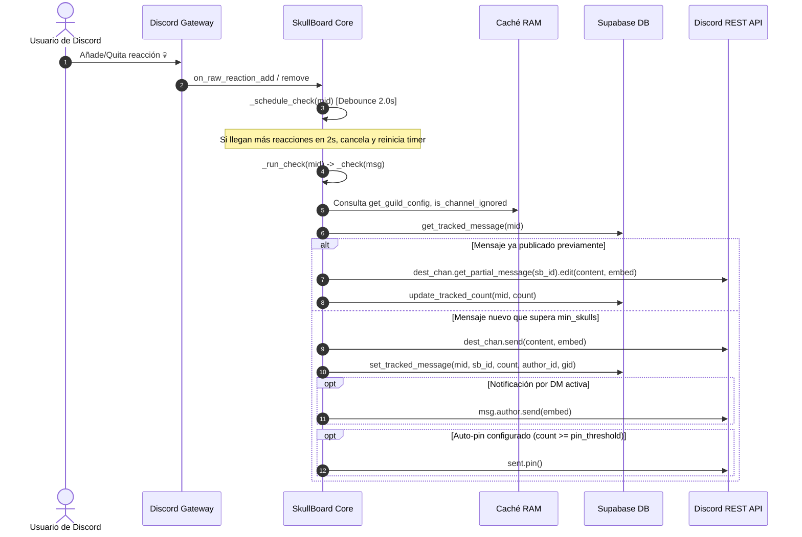
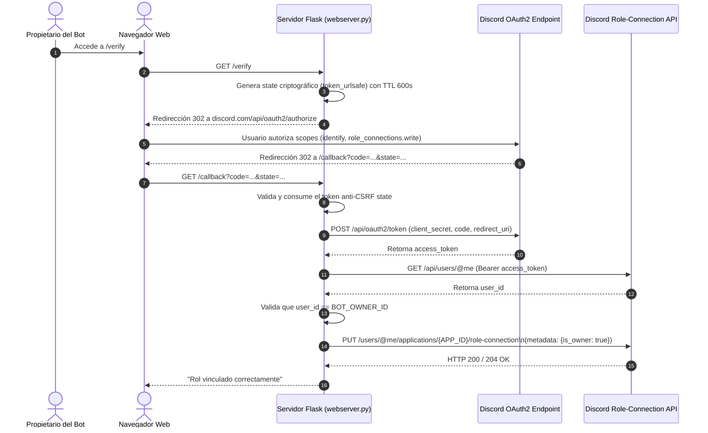

# SkullBoard — Documentación de Arquitectura de Software

## 1. Visión General del Sistema

SkullBoard es un bot de Discord especializado en la funcionalidad de *Starboard* (reacciones con el emoji 💀) diseñado para alta concurrencia y bajo consumo de recursos en entornos multi-servidor (*multi-tenant*).

El sistema opera en un **único proceso de Python** distribuido en dos contextos de ejecución:
1. **Asyncio Event Loop (Main Thread):** Ejecuta el cliente `discord.py` (`SkullBot`), el árbol de comandos slash (`GuildOnlyTree`), los listeners de eventos de Discord y las llamadas asíncronas a la base de datos Supabase mediante `supabase.AsyncClient`.
2. **Dedicated OS Thread (`webserver.keep_alive()`):** Ejecuta un servidor WSGI Flask multihilo (`threaded=True`) en el puerto 8080 para gestionar el handshake OAuth2 (Linked Roles de Discord), proveer endpoints REST públicos de estadísticas (`/api/stats`), servir formularios de contacto con entrega de emails vía Resend (`/api/contact`) y servir páginas HTML legales estáticas (`legal/`).

---

## 2. Diagrama de Interacción de Componentes

```mermaid
flowchart TD
    subgraph Discord_Cloud["Plataforma Discord"]
        GW["Discord Gateway (WebSockets)\n(RAW Reaction, Message Delete, Guild Events)"]
        REST["Discord REST API v10\n(Messages, Edits, Deletions, Pins, OAuth2, Metadata)"]
        ClientUser["Usuarios / Administradores"]
    end

    subgraph SkullBoard_Process["Proceso Python (Single Process)"]
        subgraph Async_Loop["Asyncio Loop (Main Thread)"]
            Bot["SkullBot (discord.ext.commands.Bot)"]
            Tree["GuildOnlyTree (app_commands.CommandTree)"]
            
            subgraph Concurrency_Control["Mecanismos de Concurrencia"]
                Debounce["Debouncer Coalescente\n(MessageDebouncer: 2.0s generacional)"]
                KeyedLocks["KeyedAsyncLock Inmune a Cancelaciones\n(_check_locks / _resync_locks)"]
                DelSem["Semáforo de Borrado\n(_delete_sem = Semaphore(8))"]
                ResyncLimiter["Rate Limiter Global\n(_GlobalRateLimiter(8))"]
                DBRetry["Decorador de Resiliencia\n(@db_retry con Exponential Backoff)"]
            end
            
            subgraph State_Caches["Caché de Estado en Memoria (RAM)"]
                CfgCache["_guild_config_cache\n(TTL: 300s)"]
                PfxCache["_prefix_cache\n(TTL: 120s)"]
                IgnCache["_ignored_channels_cache\n(TTL: 300s)"]
                RecCache["_guild_record_cache\n(TTL: 300s)"]
                NotifCache["notify_disabled_cache\n(Set de tuplas (gid, uid))"]
            end
        end

        subgraph Thread_Worker["Flask Worker Thread"]
            Flask["Flask App (port 8080)"]
            StatsCache["_stats_cache (TTL: 60s)"]
            ContactThrottle["_contact_last (IP Throttling)"]
            OAuthStates["_oauth_states (Anti-CSRF Tokens, TTL: 600s)"]
        end
    end

    subgraph Data_Tier["Capa de Persistencia"]
        SupaClient["Supabase AsyncClient (PostgREST HTTP/2)"]
        Postgres[(Base de Datos PostgreSQL / Supabase)]
    end

    %% Flujos de interacción
    ClientUser -->|Reacciones / Mensajes| GW
    GW -->|on_raw_reaction_add/remove| Debounce
    Debounce -->|2.0s delay| MsgLocks
    MsgLocks -->|Fetch / Repost / Edit| REST
    MsgLocks <-->|Lectura / Invalidación| State_Caches
    MsgLocks -->|CRUD tracked_messages| SupaClient

    GW -->|on_raw_message_delete (bulk)| DelSem
    DelSem -->|DELETE batched in_()| SupaClient
    DelSem -->|Delete reposts| REST

    Tree -->|Slash Commands| ResyncLocks
    ResyncLocks --> ResyncLimiter
    ResyncLimiter -->|Reconciliation| REST
    ResyncLimiter -->|Upsert / Delete| SupaClient

    ClientUser -->|HTTP GET /verify /callback| Flask
    Flask -->|OAuth2 Token Exchange| REST
    Flask -->|REST Count Queries| Postgres
    SupaClient <--> Postgres
```

---

## 3. Manejo del Estado Global y Mecanismos de Concurrencia

### 3.1. Estrategia de Caché en Memoria
El bot minimiza las lecturas a Supabase mediante variables globales con políticas de invalidación reactiva y TTL:

| Caché | Estructura | TTL | Política de Infracción / Invalidación |
| :--- | :--- | :--- | :--- |
| `_guild_config_cache` | `dict[guild_id, tuple[dict, timestamp]]` | 300 s | Se invalida explícitamente en `update_guild_config()` (`.pop()`). |
| `_prefix_cache` | `dict[guild_id, tuple[str, timestamp]]` | 120 s | Se invalida explícitamente en `update_guild_config()` y comandos de prefijo. |
| `_ignored_channels_cache` | `dict[guild_id, tuple[set[channel_id], timestamp]]` | 300 s | Se invalida en `add_ignored_channel()` y `remove_ignored_channel()`. |
| `_guild_record_cache` | `dict[guild_id, tuple[int, timestamp]]` | 300 s | Se invalida al insertar, editar o eliminar registros de `tracked_messages`. |
| `notify_disabled_cache` | `set[tuple[guild_id, user_id]]` | Persistente | Se precarga al inicio (`load_notify_cache()`) y se sincroniza en caliente en `set_notify()`. |
| `_stats_cache` (Web) | `dict[str, Any]` | 60 s | Caché de recuentos de tablas (`settings`, `tracked_messages`) servida en `/api/stats`. |

### 3.2. Mecanismos de Concurrencia y Sincronización

1. **Debounce Coalescente de Reacciones (`processing_messages`):**
   - Cuando se añade o quita una reacción `💀`, `_schedule_check()` cancela cualquier temporizador previo para ese `message_id` y programa un `call_later(2.0, ...)`.
   - Si 20 usuarios reaccionan en ráfaga a un mensaje en menos de 2 segundos, solo se ejecuta un único ciclo de verificación (`_run_check`), evitando el spam de peticiones a la API de Discord y a la base de datos.

2. **Locks Asíncronos con Gestión de Ciclo de Vida (`KeyedAsyncLock`):**
   - Garantiza que dos eventos simultáneos sobre el mismo mensaje o servidor se procesen de forma estrictamente secuencial (`_check_locks` para mensajes y `_resync_locks` para servidores).
   - Implementa un mecanismo cancellation-safe: si una corrutina se cancela mientras espera `acquire()`, el contador de referencias se decrementa inmediatamente y el lock se desaloja en `except BaseException`, evitando bloqueos fantasmas o fugas de memoria en RAM.

3. **Semáforo de Borrado Concurrente (`_delete_sem = asyncio.Semaphore(8)`):**
   - Limita a 8 las tareas concurrentes que procesan eliminaciones de mensajes.
   - Previene el agotamiento de los 100 streams HTTP/2 concurrentes del cliente Supabase y evita picos de uso de CPU/RAM durante purgas masivas (*message bulk deletes*).

4. **Rate Limiting Global de Resync (`_GlobalRateLimiter`):**
   - Implementa un algoritmo de *Token Bucket / Leaky Bucket* con `asyncio.Lock` que limita a **8 peticiones/segundo** el total agregado de llamadas a la API de Discord efectuadas por tareas de resincronización en todo el proceso.
   - Protege el bot contra el baneo temporal por superar el rate limit global de Discord (~50 req/s), aislando la ejecución concurrente de `/resync` en múltiples servidores.

5. **Decorador de Resiliencia de Red (`@db_retry`):**
   - Envuelve las consultas a Supabase con reintentos automáticos (hasta 3 intentos) con *exponential backoff* y *jitter* aleatorio para absorber desconexiones transitorias sin causar caídas.

---

## 4. Flujos Lógicos Principales

### 4.1. Flujo de Reacciones y Publicación en Starboard


### 4.2. Flujo de Deduplicación y Reconciliación (`/resync`)
El comando `/resync` escanea el canal configurado del skullboard para corregir inconsistencias históricas:
1. **Adquisición de Locks:** Adquiere el lock específico del servidor en `_resync_guild_locks`.
2. **Escaneo de Historial:** Lee todos los mensajes del canal de skullboard publicados por el bot (`sb_chan.history(limit=None)`).
3. **Extracción y Agrupación:** Extrae el enlace original del mensaje usando regex `discord.com/channels/\d+/(\d+)/(\d+)` en el embed y agrupa los reposts bajo el `orig_msg_id`.
4. **Determinación del Superviviente (*Survivor*):** Ordena los reposts cronológicamente de forma descendente. El más reciente se selecciona como superviviente; el resto se clasifica como `extras` (duplicados).
5. **Reconciliación con Mensaje Original:**
   - Realiza un `fetch_message(orig_msg_id)` con rate limit controlado por `_resync_limiter`.
   - Si el mensaje original fue **eliminado** (`discord.NotFound`): elimina todos los reposts asociados en Discord y borra las filas en `tracked_messages` de Supabase.
   - Si el mensaje original **existe**:
     - Elimina los reposts duplicados (`extras`) en Discord y en BD.
     - Compara el recuento actual del repost con el recuento real de reacciones del mensaje original.
     - Si difiere, edita el repost con el conteo actualizado y ejecuta un `db_upsert` en `tracked_messages`.
6. **Reporte:** Emite un embed con el resumen detallado de mensajes sincronizados, duplicados eliminados y huérfanos purgados.

### 4.3. Flujo OAuth2 y Linked Roles de Discord


---

## 5. Esquema de Base de Datos Inferido (Supabase / PostgreSQL)

A partir del código fuente de `main.py` y `webserver.py`, se infiere el siguiente esquema relacional:

### Tabla: `settings`
Almacena la configuración por servidor.
```sql
CREATE TABLE public.settings (
    guild_id                TEXT PRIMARY KEY,          -- Snowflake ID del servidor (como string)
    skullboard_channel_id   BIGINT NOT NULL DEFAULT 0, -- Canal destino del Starboard
    min_skulls              SMALLINT NOT NULL DEFAULT 1, -- Mínimo de reacciones necesarias
    prefix                  TEXT NOT NULL DEFAULT 'sk!', -- Prefijo de comandos de texto
    pin_threshold           SMALLINT NOT NULL DEFAULT 0  -- Umbral de auto-pin (0 = desactivado)
);
```

### Tabla: `tracked_messages`
Registra la correspondencia entre los mensajes originales y sus publicaciones en el Starboard.
```sql
CREATE TABLE public.tracked_messages (
    message_id              TEXT PRIMARY KEY,          -- Snowflake ID del mensaje original
    skullboard_message_id   BIGINT NOT NULL,           -- Snowflake ID del mensaje publicado en el Starboard
    skull_count             SMALLINT NOT NULL DEFAULT 0, -- Conteo de calaveras (clamped a 32767)
    author_id               TEXT NOT NULL,             -- Snowflake ID del autor del mensaje original
    guild_id                TEXT NOT NULL              -- Snowflake ID del servidor (Foreign Key lógica)
);

-- Índices inferidos para optimizar consultas de rankings y reseteo:
CREATE INDEX idx_tracked_messages_guild_skulls ON public.tracked_messages (guild_id, skull_count DESC);
CREATE INDEX idx_tracked_messages_guild_author ON public.tracked_messages (guild_id, author_id);
CREATE INDEX idx_tracked_messages_sb_id ON public.tracked_messages (skullboard_message_id);
```

### Tabla: `ignored_channels`
Canales de texto donde las reacciones no son procesadas por el bot.
```sql
CREATE TABLE public.ignored_channels (
    guild_id                TEXT NOT NULL,             -- Snowflake ID del servidor
    channel_id              TEXT NOT NULL,             -- Snowflake ID del canal ignorado
    PRIMARY KEY (guild_id, channel_id)
);
```

### Tabla: `notify_settings`
Preferencias de usuarios que deciden no recibir DMs cuando sus mensajes llegan al Starboard.
```sql
CREATE TABLE public.notify_settings (
    guild_id                TEXT NOT NULL,             -- Snowflake ID del servidor
    user_id                 TEXT NOT NULL,             -- Snowflake ID del usuario
    enabled                 BOOLEAN NOT NULL DEFAULT true, -- Estado de notificación
    PRIMARY KEY (guild_id, user_id)
);

CREATE INDEX idx_notify_settings_disabled ON public.notify_settings (guild_id, user_id) WHERE enabled = false;
```
