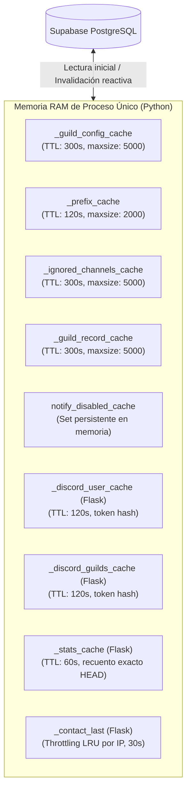
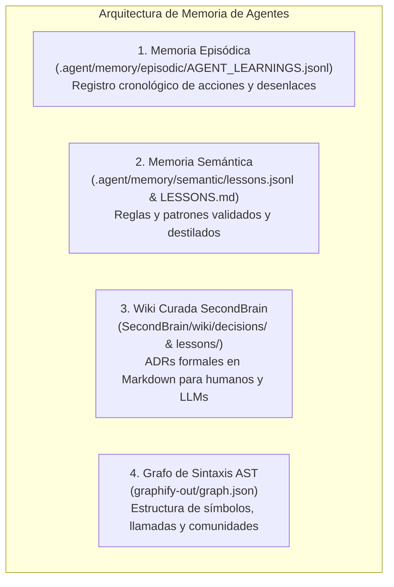
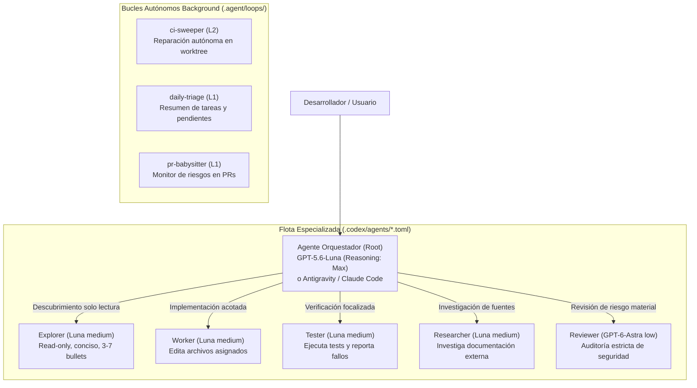

# 💀 PROJECT_SUMMARY.md — Documento Maestro de Contexto Técnico Definitivo

> **ESTADO DEL SISTEMA:** PRODUCCIÓN / VIVO  
> **VERSIÓN ARQUITECTÓNICA:** v2.5.2 (AutoShardedBot, Dashboard OAuth2 Cifrado Fernet, Sapphire Multi-column Footer, Status API en Vivo, Knowledge Graph AST, 100% Suites de Pruebas Aprobadas)  
> **FECHA DE CORTE Y AUDITORÍA:** Septiembre 2026  
> **PROPIETARIO TÉCNICO:** GlobalFerociouS (`BOT_OWNER_ID`: `561225979389804544`)  
> **DISCORD APPLICATION ID:** `1367463352774955059`  
> **DOMINIOS OFICIALES:**  
> - Frontend & Dashboard Web: [https://skullboard.vercel.app/](https://skullboard.vercel.app/)  
> - Backend API REST & Webhook: [https://skullboard-fqf1.onrender.com](https://skullboard-fqf1.onrender.com)  
> - Canal de Soporte: globalsupportpyt@gmail.com  

---

## 1. Resumen Ejecutivo

### 1.1 Descripción Precisa del Proyecto
**SkullBoard** es un bot de Discord multi-servidor (*multi-tenant*) de alto rendimiento especializado en la dinámica de **Starboard temático de calaveras (`💀`)**, complementado con una suite web completa que incluye un **Panel de Control (Dashboard Web)** con autenticación OAuth2 de Discord, un portal público responsivo de documentación legal y changelog (`legal/`), y un sistema de verificación de roles enlazados (*Linked Roles*).

El proyecto resuelve la problemática de escalabilidad, sobrecoste de llamadas a la API de Discord y condiciones de carrera asociadas a la gestión masiva de reacciones en comunidades multitudinarias. A diferencia de bots genéricos que saturan los límites de tasa de Discord o consumen memoria desproporcionada realizando agregaciones en Python, SkullBoard implementa **coalescencia de eventos (debouncing generacional de 2.0s)**, **locks asíncronos por clave seguros contra cancelaciones (`KeyedAsyncLock`)**, **persistencia en PostgreSQL (Supabase)** con funciones de agregación nativas (RPCs) y una política innegociable de **Zero-Data Retention** sobre el contenido textual de los mensajes.

Adicionalmente, el repositorio aloja un ecosistema de desarrollo autónomo pionero en la industria asistida por Inteligencia Artificial: un **cerebro portátil multi-IA (`.agent/` y `SecondBrain/`)** diseñado para conectar y sincronizar a **Google Antigravity**, **OpenAI Codex**, **Claude Code**, **Cursor** y **OpenCode**, erradicando la amnesia entre sesiones, optimizando hasta un 75% el consumo de tokens y garantizando control estricto de concurrencia de agentes mediante bucles de control (`.agent/loops/`), habilidades estandarizadas (`.agent/skills/`) y grafos de sintaxis AST (`graphify-out/`).

### 1.2 Objetivo Principal y Secundarios
* **Objetivo Principal:** Proveer una experiencia de Starboard ultrarrápida, estéticamente cuidada y con cero pérdida de datos ni desincronizaciones de conteo en servidores de Discord de cualquier tamaño.
* **Objetivos Secundarios:**
  1. *Seguridad Criptográfica y Privacidad:* Garantizar que ninguna credencial OAuth viaje al navegador en texto claro mediante sesiones opacas en cookies `__Host-` cifradas con Fernet (AES-128-CBC + HMAC-SHA256).
  2. *Eficiencia de Cómputo e I/O:* Ejecutar el bot de Discord y la API web dentro de un **único proceso de Python** desacoplado en dos hilos, minimizando el consumo de RAM a < 100 MB.
  3. *Observabilidad en Tiempo Real:* Transmitir alertas de infraestructura, caídas de shards y excepciones no controladas mediante webhooks enriquecidos a Discord (`send_system_alert`).
  4. *Gobernanza Multi-Agente:* Permitir que agentes de IA operen concurrentemente sobre el repositorio sin pisar código, utilizando grafos de conocimiento AST (`Graphify`), memorias episódicas y semánticas, y protocolos de entrevista previa (`/grill-me`).

### 1.3 Estado Actual Real del Proyecto
* **Producción Activa:** Desplegado en **Render PaaS** (backend en Python 3.11/3.14 con `AutoShardedBot` + Flask WSGI) y en **Vercel Edge Network** (frontend estático con Clean URLs y proxy inverso para endpoints `/api/*`).
* **Base de Datos:** PostgreSQL 15+ en **Supabase** con RLS (*Row Level Security*) en modo *deny-by-default* para clientes públicos, y RPCs optimizadas que consolidan leaderboards, récords y conteos temporales.
* **Fidelidad de Pruebas (100% Aprobación en 7 Suites):**
  - Suite de 50 salvaguardas arquitectónicas ([`scripts/safeguards_test.py`](file:///c:/Users/Fer/Desktop/BOT_DC/Skullboard/scripts/safeguards_test.py)): **50/50 checks aprobados**.
  - Suite de 26 pruebas unitarias de autenticación web ([`scripts/test_dashboard_auth.py`](file:///c:/Users/Fer/Desktop/BOT_DC/Skullboard/scripts/test_dashboard_auth.py)): **26/26 tests aprobados**.
  - Suite de 27 pruebas de estrés adversarial ([`scripts/challenger_stress_test.py`](file:///c:/Users/Fer/Desktop/BOT_DC/Skullboard/scripts/challenger_stress_test.py)): **27/27 tests aprobados**.
  - Suite de 4 escenarios de ataque a endpoints ([`scripts/adversarial_attack_scenarios.py`](file:///c:/Users/Fer/Desktop/BOT_DC/Skullboard/scripts/adversarial_attack_scenarios.py)): **4/4 tests aprobados**.
  - Suite de resiliencia y reconexión DB ([`scripts/adversarial_challenge_test.py`](file:///c:/Users/Fer/Desktop/BOT_DC/Skullboard/scripts/adversarial_challenge_test.py)): **Aprobada**.
  - Suite de 8 pruebas de regresión frontend en Node.js ([`scripts/dashboard_regression.test.cjs`](file:///c:/Users/Fer/Desktop/BOT_DC/Skullboard/scripts/dashboard_regression.test.cjs)): **8/8 tests aprobados**.
  - Auditoría estática de rutas ([`scripts/route_security_audit.py`](file:///c:/Users/Fer/Desktop/BOT_DC/Skullboard/scripts/route_security_audit.py)): **20 rutas activas auditadas**.

### 1.4 Stack Tecnológico Completo y Versiones Relevantes
* **Lenguaje Principal:** Python 3.10+ (probado operativamente en 3.11 en Render y 3.14 en entorno local Windows).
* **Discord Bot Framework:** [`discord.py`](file:///c:/Users/Fer/Desktop/BOT_DC/Skullboard/requirements.txt#L1) $\ge 2.5.0$ utilizando [`discord.ext.commands.AutoShardedBot`](file:///c:/Users/Fer/Desktop/BOT_DC/Skullboard/main.py#L485) y [`discord.app_commands.CommandTree`](file:///c:/Users/Fer/Desktop/BOT_DC/Skullboard/main.py#L468) sobre Discord API v10 / Gateway v10.
* **Servidor Web / API:** [`Flask`](file:///c:/Users/Fer/Desktop/BOT_DC/Skullboard/requirements.txt#L2) $\ge 3.1.0$ ejecutado en un hilo secundario con soporte WSGI multihilo (`threaded=True`).
* **Capa Asíncrona & Optimización:** [`uvloop`](file:///c:/Users/Fer/Desktop/BOT_DC/Skullboard/requirements.txt#L10) $\ge 0.21.0$ (en plataformas POSIX / Linux en Render) y `asyncio` estándar en Windows.
* **Serialización de Alto Rendimiento:** [`orjson`](file:///c:/Users/Fer/Desktop/BOT_DC/Skullboard/requirements.txt#L6) $\ge 3.10.0$ con fallback automático a `json` de la biblioteca estándar.
* **Caché en Memoria:** [`cachetools`](file:///c:/Users/Fer/Desktop/BOT_DC/Skullboard/requirements.txt#L5) $\ge 5.5.0$ (`TTLCache`) complementado con la implementación nativa [`BoundedTTLCache`](file:///c:/Users/Fer/Desktop/BOT_DC/Skullboard/main.py#L171).
* **Persistencia & Cloud DB:** [`supabase`](file:///c:/Users/Fer/Desktop/BOT_DC/Skullboard/requirements.txt#L4) $\ge 2.10.0$ con [`AsyncClient`](file:///c:/Users/Fer/Desktop/BOT_DC/Skullboard/main.py#L15) para el bot y cliente HTTP sincrónico para Flask.
* **Criptografía & Seguridad:** [`cryptography`](file:///c:/Users/Fer/Desktop/BOT_DC/Skullboard/requirements.txt#L8) $\ge 44.0.0$ (`Fernet` simétrico y derivación HMAC-SHA256).
* **Email API:** [`resend`](file:///c:/Users/Fer/Desktop/BOT_DC/Skullboard/requirements.txt#L9) $\ge 2.6.0$ y HTTP REST directo.
* **Monitoreo de Procesos:** [`psutil`](file:///c:/Users/Fer/Desktop/BOT_DC/Skullboard/requirements.txt#L7) $\ge 6.0.0$ para el cálculo de consumo de memoria RSS y uptime.
* **Frontend Web:** HTML5 Semántico, CSS3 moderno con variables y tokens cromáticos de lujo, JavaScript Vanilla (ES6+), Web App Manifest (PWA) y Service Worker (`sw.js`).
* **Hosting & CDN:** Render (backend container/process) y Vercel (frontend edge hosting con reescrituras de rutas same-origin).

---

## 2. Estructura del Proyecto (OBLIGATORIO)

### 2.1 Árbol de Directorios Completo y Exhaustivo
```text
c:\Users\Fer\Desktop\BOT_DC\Skullboard\
├── .agent/                             # Cerebro portátil ejecutable (Agentic Stack)
│   ├── harness/                        # Adaptadores y presupuesto de contexto LLM
│   │   ├── hooks/                      # Hooks de interceptación por harness de IA
│   │   │   ├── _episodic_io.py         # I/O atómico para memoria episódica
│   │   │   ├── _provenance.py          # Metadatos de procedencia y trazabilidad
│   │   │   ├── claude_code_post_tool.py # Hook post-herramienta para Claude Code
│   │   │   ├── copilot_cli_post_tool.py # Hook post-herramienta para Copilot CLI
│   │   │   ├── on_failure.py           # Captura de excepciones no controladas
│   │   │   ├── pi_post_tool.py         # Hook post-herramienta para Pi harness
│   │   │   ├── post_execution.py       # Hook de cierre de sesión
│   │   │   └── pre_tool_call.py        # Validación previa a la invocación de herramientas
│   │   ├── conductor.py                # Conductor de ejecución y secuenciación
│   │   ├── context_budget.py           # Cálculo y recorte de ventana de contexto
│   │   ├── llm.py                      # Abstracción de cliente LLM para herramientas
│   │   ├── salience.py                 # Ponderación de saliencia de episodios (0.0 - 1.0)
│   │   └── text.py                     # Normalización y utilidades de texto
│   ├── loops/                          # Bucles de control y agentes autónomos background
│   │   ├── budget.json                 # Límites globales de tokens, intentos y tiempo
│   │   ├── ci-sweeper.json             # Agente L2: resolución autónoma de fallos en CI
│   │   ├── constraints.json            # Restricciones operativas fail-closed (deny_paths)
│   │   ├── daily-triage.json           # Agente L1: triage diario y resumen de pendientes
│   │   ├── harnesses.json              # Perfiles de ejecución (maker, checker, reporter)
│   │   └── pr-babysitter.json          # Agente L1: monitor de riesgos en pull requests
│   ├── memory/                         # Sistema de memoria multi-capa del agente
│   │   ├── candidates/                 # Lecciones candidatas generadas en auto-sueño
│   │   │   └── graduated/              # Registro histórico de lecciones graduadas (JSON)
│   │   │       ├── 1e25c0b454be.json
│   │   │       ├── 422695ae5b2d.json
│   │   │       ├── 511129d5f911.json
│   │   │       └── 5c0b2a1cce57.json
│   │   ├── episodic/                   # Memoria episódica cronológica cruda
│   │   │   └── AGENT_LEARNINGS.jsonl   # Eventos, reflexiones y resultados
│   │   ├── personal/                   # Memoria personal y estilo del usuario
│   │   │   └── PREFERENCES.md          # Preferencias del desarrollador
│   │   ├── semantic/                   # Memoria semántica destilada y validada
│   │   │   ├── DECISIONS.md            # Registro semántico de decisiones
│   │   │   ├── DOMAIN_KNOWLEDGE.md     # Hechos estables del dominio de Discord/PaaS
│   │   │   ├── LESSONS.md              # Lecciones destiladas compiladas para inyección
│   │   │   └── lessons.jsonl           # Base de datos fuente inmutable de lecciones
│   │   ├── working/                    # Memoria de trabajo a corto plazo
│   │   │   ├── REVIEW_QUEUE.md         # Cola de lecciones pendientes de revisión humana/host
│   │   │   └── WORKSPACE.md            # Estado actual de la tarea en curso
│   │   ├── archive.py                  # Archivado de memorias obsoletas
│   │   ├── auto_dream.py               # Ciclo de sueño: extracción y clusterización
│   │   ├── cluster.py                  # Algoritmo de agrupamiento léxico
│   │   ├── decay.py                    # Decaimiento temporal de saliencia
│   │   ├── memory_search.py            # Búsqueda semántica y léxica
│   │   ├── promote.py                  # Promoción de candidato a graduado
│   │   ├── render_lessons.py           # Compilador determinista de lessons.jsonl a LESSONS.md
│   │   ├── review_state.py             # Máquina de estados de la cola de revisión
│   │   └── validate.py                 # Validador heurístico anti-basura y anti-duplicados
│   ├── protocols/                      # Reglas de delegación y permisos estrictos
│   │   ├── tool_schemas/               # Esquemas JSON tipados de herramientas externas
│   │   │   ├── api.schema.json         # Contrato para llamadas HTTP REST (GET/POST)
│   │   │   ├── github.schema.json      # Contrato para interacciones con la API de GitHub
│   │   │   └── shell.schema.json       # Contrato de comandos bash con patrones bloqueados
│   │   ├── delegation.md               # Contrato formal de handoff a subagentes
│   │   ├── hook_patterns.json          # Patrones regex de captura de hooks
│   │   └── permissions.md              # Matriz de permisos de herramientas (Allow/Deny)
│   ├── runtime/                        # Estados volátiles de ejecución (.gitignore)
│   │   └── .gitignore
│   ├── skills/                         # Catálogo de 25 habilidades modulares (.agent)
│   │   ├── _index.md                   # Índice humano de habilidades
│   │   ├── _manifest.jsonl             # Manifiesto estructurado para IAs
│   │   ├── brain/                      # Puente con memoria externa compartida
│   │   ├── caveman/                    # Modo de compresión de tokens Always-On
│   │   ├── code-review/                # Auditoría doble (estándares y especificación)
│   │   ├── data-flywheel/              # Exportación de trazas para evaluación y entreno
│   │   ├── data-layer/                 # Dashboard HTML y analítica de uso de agentes
│   │   ├── debug-investigator/         # Metodología de análisis de causas raíz
│   │   ├── deploy-checklist/           # Protocolo de verificación previo a despliegue
│   │   ├── design-md/                  # Consumo de tokens de diseño desde DESIGN.md
│   │   ├── discord-py-advanced-patterns/ # Patrones de alta escala en discord.py
│   │   ├── git-proxy/                  # Operaciones git seguras (bloquea force push)
│   │   ├── locust-discord-load-testing/ # Scripts de prueba de carga y estrés
│   │   ├── loop-constraints/           # Guardián de rutas protegidas y deny_paths
│   │   ├── loop-guard/                 # Control de presupuesto de tokens en bucles
│   │   ├── loop-triage/                # Clasificación de tareas en bucles autónomos
│   │   ├── loop-verifier/              # Ejecutor de comprobaciones deterministas
│   │   ├── memory-manager/             # Gestión y reflexión de memorias cognitivas
│   │   ├── modern-ui-ux-design-system/ # Tokens visuales y componentes web de lujo
│   │   ├── playwright-visual-testing/  # Pruebas de regresión visual responsive
│   │   ├── ponytail/                   # Forzado de soluciones mínimas y YAGNI
│   │   ├── python-asyncio-performance/ # Optimización de uvloop, locks y memoria
│   │   ├── skillforge/                 # Generador y refinador de nuevas skills
│   │   ├── supabase/                   # Interacción y soporte con la suite Supabase
│   │   ├── supabase-postgres-best-practices/ # 8 categorías de optimización PostgreSQL
│   │   ├── tldraw/                     # Generación de diagramas y wireframes visuales
│   │   └── web-seo-and-social-cards/   # Optimización OpenGraph, SEO y JSON-LD
│   ├── tools/                          # Suite CLI de gestión de memoria del host
│   │   ├── brain_bridge.py             # Puente con herramienta Brain CLI externa
│   │   ├── budget_tracker.py           # Monitor de consumo de cuota
│   │   ├── data_flywheel_export.py     # Exportador de trazas y datasets de entreno
│   │   ├── data_layer_export.py        # Generador de dashboard HTML de actividad
│   │   ├── graduate.py                 # Graduador de lecciones candidatas
│   │   ├── learn.py                    # Enseñar una lección en un solo paso
│   │   ├── list_candidates.py          # Listar candidatos de auto_dream
│   │   ├── memory_reflect.py           # Registrar un evento en AGENT_LEARNINGS.jsonl
│   │   ├── recall.py                   # Recuperación léxica previa a tareas críticas
│   │   ├── reject.py                   # Rechazar lección candidata
│   │   ├── reopen.py                   # Reabrir lección archivada
│   │   ├── retract_lesson.py           # Retirar lección obsoleta o errónea
│   │   ├── show.py                     # Dashboard de terminal sobre salud del brain
│   │   ├── skill_loader.py             # Cargador dinámico de skills
│   │   └── test_learn_episodic_mirror.py # Tests unitarios de sincronización
│   ├── AGENTS.md                       # Manifiesto y mapa de arquitectura del brain
│   ├── install.json                    # Manifiesto de instalación y versiones
│   └── install.json.lock               # Lockfile de dependencias del agente
├── .agents/                            # Configuración compartida entre harnesses
│   ├── rules/                          # Reglas operativas universales Always-On
│   │   ├── caveman.md                  # Regla de estilo conciso Caveman
│   │   ├── change-awareness.md         # Regla de detección de cambios git
│   │   ├── discord-verification-and-intents.md # Defensa de intents privilegiados
│   │   ├── graphify.md                 # Navegación con AST Graphify
│   │   ├── mobile-first-web-standards.md # Estándares responsive y accesibilidad
│   │   └── proactive-skill-and-mcp-orchestration.md # Uso proactivo de skills/MCP
│   ├── skills/                         # Espejo de habilidades modulares
│   └── workflows/                      # Workflows migrados (graphify.md.bak)
├── .claude/                            # Configuración para Claude Code
│   ├── launch.json                     # Configuraciones de ejecución
│   ├── settings.json                   # Ajustes generales
│   ├── settings.local.json             # Ajustes locales y permisos concedidos
│   └── worktrees/                      # Gestión de árboles de trabajo concurrentes
│       └── awesome-curie-438811/       # Worktree git aislado de ejecución paralela
├── .codex/                             # Configuración para OpenAI Codex
│   ├── agents/                         # Definición de subagentes especializados
│   │   ├── explorer.toml               # Subagente de exploración solo-lectura
│   │   ├── researcher.toml             # Subagente de investigación técnica
│   │   ├── reviewer.toml               # Subagente de revisión crítica (Astra)
│   │   ├── tester.toml                 # Subagente de ejecución de tests
│   │   └── worker.toml                 # Subagente de implementación de código
│   ├── config.toml                     # Configuración del orquestador Luna-max
│   └── hooks.json                      # Hook PreToolUse para graphify hook-check
├── .cursor/                            # Configuración para Cursor IDE
│   └── rules/                          # Reglas MDC AlwaysApply
│       ├── caveman.mdc                 # Directiva Caveman para Cursor
│       ├── change-awareness.mdc        # Directiva Change Awareness
│       └── graphify.mdc                # Directiva Graphify
├── .gemini/                            # Configuración para Google Gemini / Antigravity
│   └── settings.json                   # Ajustes del entorno de Gemini
├── .git/                               # Repositorio Git
│   └── hooks/                          # Hooks locales de sincronización automática
├── .opencode/                          # Configuración para OpenCode
│   ├── plugins/                        # Extensiones locales
│   │   └── graphify.js                 # Plugin de integración de Graphify
│   └── opencode.json                   # Ajustes de OpenCode
├── SecondBrain/                        # Wiki curada de conocimiento para humanos y LLMs
│   ├── catalog/                        # Catálogos JSONL de fuentes y exclusiones
│   │   ├── exclusions.jsonl            # Patrones de exclusión de ingestión
│   │   ├── pages.jsonl                 # Registro de páginas documentadas
│   │   └── sources.jsonl               # Fuentes canónicas de conocimiento
│   ├── config/                         # Políticas y esquemas de enrutamiento
│   │   ├── integrations.md             # Integración con herramientas externas
│   │   ├── policy.md                   # Política editorial del SecondBrain
│   │   ├── projects.yaml               # Metadata de proyectos enlazados
│   │   ├── routing.yaml                # Enrutamiento de consultas por categoría
│   │   └── sources.yaml                # Especificación YAML de fuentes
│   ├── operations/                     # Manuales de ingestión, mantenimiento y query
│   │   ├── ingest.md                   # Procedimiento de ingestión documental
│   │   ├── maintain.md                 # Mantenimiento y saneamiento de enlaces
│   │   ├── query.md                    # Manual de consulta rápida
│   │   └── restore.md                  # Procedimiento de respaldo y recuperación
│   ├── wiki/                           # Base de conocimiento indexada
│   │   ├── concepts/                   # Conceptos clave del dominio
│   │   ├── decisions/                  # ADRs formales (001, 002)
│   │   │   ├── 001-agentic-stack-setup.md # Montaje del cerebro compartido
│   │   │   └── 002-oauth-werewolf-and-security-audit.md # Patrón Werewolf y auth
│   │   ├── lessons/                    # Lecciones destiladas (001)
│   │   │   └── 001-oauth-scope-tolerance.md # Tolerancia de scopes en Discord
│   │   ├── projects/                   # Ficha de arquitectura del proyecto
│   │   │   └── skullboard.md           # Resumen de arquitectura del bot
│   │   ├── workflows/                  # Flujos de trabajo estandarizados
│   │   │   └── token-efficient-audit.md # Metodología de auditoría económica
│   │   └── index.md                    # Índice maestro navegable
│   ├── AGENTS.md                       # Contrato de operación para el SecondBrain
│   └── README.md                       # Guía de estructura del repositorio de conocimiento
├── docs/                               # Documentación técnica maestra del proyecto
│   ├── ARCHITECTURE.md                 # Arquitectura de software, diagramas y concurrencia
│   ├── COMMANDS.md                     # Manual detallado de comandos de Discord
│   ├── DECISIONS.md                    # Registro cronológico y espejo de ADRs y lecciones
│   ├── MCP_AND_SKILLS.md               # Manual maestro de MCPs, Skills y /grill-me
│   ├── MULTI_AGENT_MEMORY_ARCHITECTURE.md # Arquitectura de conexión multi-IA
│   ├── NEW_AGENT_ONBOARDING_GUIDE.md   # Guía de incorporación para nuevas IAs
│   ├── PLAN_DASHBOARD_LUNA.md          # Plan integral y auditoría de seguridad web
│   ├── SECURITY.md                     # Política de seguridad, credenciales y RLS
│   └── SYSTEM_CONTEXT.md               # Documento maestro de gobernanza y reglas de oro
├── graphify-out/                       # Grafo de conocimiento de sintaxis (AST)
│   ├── graph.json                      # Grafo relacional completo de símbolos y llamadas
│   ├── graph.html                      # Visualizador interactivo en canvas HTML5
│   ├── GRAPH_REPORT.md                 # Informe sintético de comunidades y nodos dios
│   └── manifest.json                   # Metadatos y firma de análisis
├── legal/                              # Frontend estático y suite de páginas web
│   ├── cambios.html                    # Historial de cambios y lanzamientos (Changelog)
│   ├── dashboard.html                  # Panel de control interactivo con OAuth2
│   ├── index.html                      # Landing page principal del bot
│   ├── manifest.json                   # Manifiesto PWA para instalación móvil
│   ├── privacy.html                    # Política de Privacidad oficial
│   ├── robots.txt                      # Directivas para motores de búsqueda
│   ├── sitemap.xml                     # Mapa del sitio con Clean URLs
│   ├── skullboard_icon.png             # Logotipo oficial en alta resolución
│   ├── styles.css                      # Hoja de estilos moderna, tema oscuro/claro y tokens
│   ├── sw.js                           # Service Worker para caché PWA offline
│   ├── terms.html                      # Términos de Servicio oficiales
│   └── vercel.json                     # Configuración de Vercel para la carpeta legal
├── scripts/                            # Suite de testing, auditoría y simulación de carga
│   ├── adversarial_attack_scenarios.py # Simulación de ataques a endpoints de API (4/4 PASS)
│   ├── adversarial_challenge_test.py   # Test de resiliencia multihilo y reconexión DB (PASS)
│   ├── challenger_stress_test.py       # Test de estrés adversarial de HTML, URLs y sliders (27/27 PASS)
│   ├── dashboard_regression.test.cjs   # Test de regresión Node.js para scripts de UI (8/8 PASS)
│   ├── route_security_audit.py         # Auditoría estática de 20 rutas Flask y auth (PASS)
│   ├── safeguards_test.py              # Suite maestra de 50 salvaguardas R1-R4 (50/50 PASS)
│   └── test_dashboard_auth.py          # 26 tests unitarios de sesión OAuth2 y cookies (26/26 PASS)
├── supabase/                           # Esquema de persistencia y migraciones SQL
│   └── migrations/                     # Archivos de migración aplicados
│       ├── 20260909_security_baseline.sql # Activación de RLS y revocación pública
│       ├── 20260909_remove_direct_public_rpc_grants.sql # Revocación de RPCs a anon
│       ├── 20260910_web_sessions.sql   # Tablas iniciales de sesiones y estados
│       └── 20260910_dashboard_sessions_transition.sql # Esquema seguro cifrado Fernet
├── .cursorrules                        # Reglas Always-On para Cursor
├── .gitattributes                      # Normalización de saltos de línea LF/CRLF
├── .gitignore                          # Exclusiones de Git (entornos, logs, cachés)
├── AGENTS.md                           # Directivas maestras unificadas para IAs
├── ANTIGRAVITY.md                      # Instrucciones de montaje para Antigravity
├── CLAUDE.md                           # Instrucciones de montaje para Claude Code
├── dashboard_sessions.py               # Módulo criptográfico de sesiones opacas Fernet
├── GEMINI.md                           # Instrucciones de montaje para Google Gemini
├── main.py                             # Núcleo del Bot de Discord (discord.py AutoShardedBot)
├── README.md                           # Portada y documentación general de bienvenida
├── requirements.txt                    # Lista de dependencias de Python del proyecto
├── skills-lock.json                    # Bloqueo de versiones y hashes de skills
├── vercel.json                         # Configuración raíz de Vercel (rewrites y headers)
└── webserver.py                        # Servidor Flask WSGI, API REST y endpoints OAuth
```

### 2.2 Propósito de Cada Carpeta Importante
* [`.agent/`](file:///c:/Users/Fer/Desktop/BOT_DC/Skullboard/.agent): Motor ejecutable de memoria portátil de la suite *agentic-stack*. Alberga las herramientas de línea de comandos (`tools/`), el almacenamiento estructurado de lecciones y preferencias (`memory/`), las definiciones de bucles de control (`loops/`), los ganchos de ejecución (`harness/hooks/`) y los protocolos estrictos de permisos y delegación (`protocols/`).
* [`.agents/`](file:///c:/Users/Fer/Desktop/BOT_DC/Skullboard/.agents): Directorio de configuración estándar compartido entre harnesses (Claude, Cursor, Codex, Gemini). Contiene las reglas permanentes en `rules/` (Caveman style, Change Awareness, Graphify) y un espejo de skills especializadas.
* [`.codex/`](file:///c:/Users/Fer/Desktop/BOT_DC/Skullboard/.codex): Configuración específica para OpenAI Codex bajo el preset **Plus Luna-max**. Define el modelo orquestador (`gpt-5.6-luna` max) y la flota de 5 subagentes especializados (`explorer`, `worker`, `tester`, `researcher`, `reviewer`).
* [`.cursor/`](file:///c:/Users/Fer/Desktop/BOT_DC/Skullboard/.cursor): Directorio de reglas MDC para Cursor IDE (`rules/caveman.mdc`, `rules/change-awareness.mdc`, `rules/graphify.mdc`). *Nota de precisión arquitectónica:* La división `cavecrew` citada en `.agent/AGENTS.md` representa una directiva de comportamiento de Cursor, sin que existan archivos físicos en `.cursor/agents/`.
* [`SecondBrain/`](file:///c:/Users/Fer/Desktop/BOT_DC/Skullboard/SecondBrain): Wiki estructurada inspirada en el método Zettelkasten y arquitectura de software. Es una base de conocimiento documental permanente curada para lectura tanto humana como de IAs, con ADRs formales en `wiki/decisions/` y análisis de lecciones aprendidas en `wiki/lessons/`.
* [`docs/`](file:///c:/Users/Fer/Desktop/BOT_DC/Skullboard/docs): Documentación técnica canónica de nivel arquitectónico, manuales de gobernanza, catálogo de comandos y especificaciones detalladas de seguridad.
* [`graphify-out/`](file:///c:/Users/Fer/Desktop/BOT_DC/Skullboard/graphify-out): Base de datos en grafo generada a partir del Árbol de Sintaxis Abstracta (AST) de todo el código Python y frontend. Permite a los agentes ejecutar búsquedas quirúrgicas sin necesidad de leer archivos completos.
* [`legal/`](file:///c:/Users/Fer/Desktop/BOT_DC/Skullboard/legal): Raíz del frontend web. Contiene el Dashboard administrativo ([`dashboard.html`](file:///c:/Users/Fer/Desktop/BOT_DC/Skullboard/legal/dashboard.html)), la página de inicio ([`index.html`](file:///c:/Users/Fer/Desktop/BOT_DC/Skullboard/legal/index.html)), el changelog interactivo ([`cambios.html`](file:///c:/Users/Fer/Desktop/BOT_DC/Skullboard/legal/cambios.html)), las páginas legales ([`privacy.html`](file:///c:/Users/Fer/Desktop/BOT_DC/Skullboard/legal/privacy.html), [`terms.html`](file:///c:/Users/Fer/Desktop/BOT_DC/Skullboard/legal/terms.html)), los estilos consolidados ([`styles.css`](file:///c:/Users/Fer/Desktop/BOT_DC/Skullboard/legal/styles.css)) y el Service Worker para PWA ([`sw.js`](file:///c:/Users/Fer/Desktop/BOT_DC/Skullboard/legal/sw.js)).
* [`scripts/`](file:///c:/Users/Fer/Desktop/BOT_DC/Skullboard/scripts): Banco de pruebas automatizadas, suites de análisis estático por AST ([`safeguards_test.py`](file:///c:/Users/Fer/Desktop/BOT_DC/Skullboard/scripts/safeguards_test.py)), pruebas de estrés multihilo, simulaciones de ataque y auditorías de seguridad.
* [`supabase/migrations/`](file:///c:/Users/Fer/Desktop/BOT_DC/Skullboard/supabase/migrations): Scripts DDL en SQL para PostgreSQL que definen las políticas de seguridad a nivel de fila (RLS), revocación de privilegios públicos y creación de esquemas para sesiones cifradas.

### 2.3 Convenciones de Nombres y Organización
* **Python (`main.py`, `webserver.py`, `dashboard_sessions.py`):** Estilo PEP 8 estricto. Variables globales internas y cachés en RAM utilizan guion bajo inicial (ej. `_guild_config_cache`, `_msg_locks`, `_stats_cache`). Los métodos RPC de Supabase se invocan en snake_case coincidiendo exactamente con la función SQL.
* **JavaScript / Frontend:** Código modular sin librerías externas (Vanilla JS), funciones en camelCase (`loadGuildConfig`, `renderLeaderboardUsers`, `triggerDiscordAuth`), constantes de estado en UPPER_SNAKE_CASE.
* **Archivos HTML / Rutas:** Regla estricta de **Clean URLs**: enrutamiento sin extensiones `.html` ([`/dashboard`](https://skullboard.vercel.app/dashboard), [`/cambios`](https://skullboard.vercel.app/cambios), [`/privacy`](https://skullboard.vercel.app/privacy), [`/terms`](https://skullboard.vercel.app/terms)).
* **Base de Datos:** Tablas en plural o descriptivas en minúsculas snake_case (`settings`, `tracked_messages`, `ignored_channels`, `notify_settings`, `dashboard_sessions`, `dashboard_oauth_states`).
* **Snowflakes de Discord:** Siempre validados como cadenas numéricas de 15 a 20 dígitos en endpoints (`_valid_guild_id`), y ordenados como enteros numéricos de 64 bits (`BIGINT`), jamás lexicográficamente.

### 2.4 Archivos de Configuración Clave y Explicación Detallada
* [`requirements.txt`](file:///c:/Users/Fer/Desktop/BOT_DC/Skullboard/requirements.txt): Declara las 10 dependencias directas de Python con sus cotas mínimas (`discord.py`, `flask`, `requests`, `supabase`, `cachetools`, `orjson`, `psutil`, `cryptography`, `resend`, `uvloop`).
* [`vercel.json`](file:///c:/Users/Fer/Desktop/BOT_DC/Skullboard/vercel.json) y [`legal/vercel.json`](file:///c:/Users/Fer/Desktop/BOT_DC/Skullboard/legal/vercel.json): Configuran el proxy inverso same-origin en la CDN de Vercel hacia Render (`/api/:path*` $\rightarrow$ `https://skullboard-fqf1.onrender.com/api/:path*`), activan `cleanUrls: true` y aplican cabeceras obligatorias `Cache-Control: no-store` en rutas dinámicas.
* [`AGENTS.md`](file:///c:/Users/Fer/Desktop/BOT_DC/Skullboard/AGENTS.md): El documento contractual supremo para cualquier agente de IA. Define las directivas de comunicación Caveman, el protocolo de memoria, el checklist de cierre obligatorio y las salvaguardas críticas de base de datos.
* [`.codex/config.toml`](file:///c:/Users/Fer/Desktop/BOT_DC/Skullboard/.codex/config.toml): Configura el orquestador general `gpt-5.6-luna` con esfuerzo `max`, limita la concurrencia a 3 subagentes paralelos y asigna los archivos TOML de los 5 roles.
* [`.codex/hooks.json`](file:///c:/Users/Fer/Desktop/BOT_DC/Skullboard/.codex/hooks.json): Intercepta llamadas Bash previas a la ejecución para validar el estado del AST mediante `graphify hook-check`.
* [`.agent/loops/constraints.json`](file:///c:/Users/Fer/Desktop/BOT_DC/Skullboard/.agent/loops/constraints.json): Define rutas protegidas contra escritura no autorizada (`deny_paths`: `.env`, `**/secrets/**`, `**/credentials/**`, `auth/**`, `**/migrations/**`) y límite de 10 archivos modificados por ciclo.
* [`skills-lock.json`](file:///c:/Users/Fer/Desktop/BOT_DC/Skullboard/skills-lock.json): Registro determinista de procedencia de skills instaladas con hashes SHA256 para prevenir ataques a la cadena de suministro de agentes.

---

## 3. Inventario Completo de Herramientas y Dependencias

### 3.1 Clasificación Exhaustiva de Dependencias
| Categoría | Paquete / Servicio | Versión Mínima | Propósito Técnico en SkullBoard |
| :--- | :--- | :--- | :--- |
| **Discord Bot** | `discord.py` | $\ge 2.5.0$ | Conexión con Gateway v10 mediante `AutoShardedBot`, eventos raw, slash commands (`GuildOnlyTree`), botones UI y REST API. |
| **Backend / WSGI** | `Flask` | $\ge 3.1.0$ | Servidor web HTTP/1.1 WSGI multihilo (`threaded=True`) que atiende la API REST, sirve el frontend estático y gestiona OAuth2. |
| **HTTP Client Síncrono** | `requests` | $\ge 2.32.0$ | Cliente síncrono en `webserver.py` para intercambios OAuth2 con Discord y llamadas REST a Supabase / Resend. |
| **HTTP Client Asíncrono**| `aiohttp` | Incluido en `discord.py` | Cliente asíncrono para despachar webhooks de alerta a Discord (`send_system_alert`). |
| **Base de Datos** | `supabase` | $\ge 2.10.0$ | Cliente oficial de Supabase. Usa `AsyncClient` en `main.py` sobre HTTP/2 PostgREST y llamadas a RPCs de PostgreSQL. |
| **Caché en RAM** | `cachetools` | $\ge 5.5.0$ | Provee `TTLCache` para expiración automática basada en tiempo y desalojo LRU de configuraciones y récords. |
| **Serialización** | `orjson` | $\ge 3.10.0$ | Serializador y deserializador ultra-rápido en C/Rust para payloads JSON de Discord y Supabase. |
| **Monitoreo** | `psutil` | $\ge 6.0.0$ | Inspección de memoria RSS, tiempo de CPU y uptime del proceso servidos en `/api/health` y `/api/status`. |
| **Criptografía** | `cryptography` | $\ge 44.0.0$ | Cifrado simétrico autenticado (`Fernet`) de tokens OAuth2 y derivación de hashes HMAC-SHA256 en `dashboard_sessions.py`. |
| **Email API** | `resend` | $\ge 2.6.0$ | Envío de correos transaccionales desde el formulario de contacto `/api/contact`. |
| **Async Loop** | `uvloop` | $\ge 0.21.0$ | Reemplazo ultrarrápido del event loop de asyncio en entornos Linux (activado si `sys.platform != 'win32'`). |
| **Frontend Web** | PWA & Vanilla JS | Estándar W3C | Service Worker (`sw.js`), Manifest PWA, CSS Custom Properties, SVG Sprites, LocalStorage para persistencia de tema. |
| **Infraestructura PaaS** | Render | Cloud Linux | Alojamiento en contenedor del proceso único de Python (Bot + Flask). |
| **Infraestructura Edge** | Vercel Edge | Global CDN | Alojamiento edge de assets estáticos, proxy de API same-origin y redirecciones 308. |
| **Testing Python** | `unittest` | Python stdlib | Framework de ejecución de suites unitarias, estáticas y adversariales. |
| **Testing Node.js** | `node:test` | Node.js 18+ | Framework de pruebas para regresión de scripts de UI en `scripts/dashboard_regression.test.cjs`. |
| **Knowledge Graph** | `graphify` | v0.9.57+ | Extractor estático de AST para análisis de comunidades, dependencias y nodos dios. |

### 3.2 Gestión de Dependencias y Lockfiles
* **Entorno Python:** Gestionado mediante `requirements.txt`. Para entornos congelados de desarrollo de agentes se dispone de [`.agent/install.json`](file:///c:/Users/Fer/Desktop/BOT_DC/Skullboard/.agent/install.json) e [`.agent/install.json.lock`](file:///c:/Users/Fer/Desktop/BOT_DC/Skullboard/.agent/install.json.lock).
* **Skills del Agente:** Gestionadas mediante [`skills-lock.json`](file:///c:/Users/Fer/Desktop/BOT_DC/Skullboard/skills-lock.json), que registra la procedencia git, la ruta del archivo y el hash SHA256 de las skills instaladas.
* **CI/CD y Verificación Local:** No requiere runners propietarios de CI para validar el repositorio; la batería local completa se ejecuta mediante comandos deterministas descritos en la Sección 8.4.

---

## 4. Gestión de Memoria (Análisis Profundo)

El proyecto cuenta con dos niveles de gestión de memoria: **Memoria de Ejecución del Sistema en Producción (Runtime RAM)** y **Memoria Cognitiva Compartida entre Agentes IA (Agent Memory Layer)**.

### 4.1 Memoria de Ejecución en Tiempo Real (Runtime Caching en RAM)
El bot opera en un proceso único y mitiga el cuello de botella de peticiones de red hacia Supabase y Discord mediante estructuras en memoria cuidadosamente controladas:



1. **`_guild_config_cache` (TTL: 300s, maxsize: 5000):** Almacena el diccionario con `skullboard_channel_id`, `min_skulls`, `prefix` y `pin_threshold`. Se invalida en caliente mediante la función `invalidate_guild_cache(guild_id)`, expuesta también de forma thread-safe hacia `webserver.py` vía `webserver.set_cache_invalidator(...)`.
2. **`_prefix_cache` (TTL: 120s, maxsize: 2000):** Resuelve instantáneamente el prefijo dinámico del servidor (`get_prefix`) en cada mensaje de Discord sin tocar la base de datos.
3. **`_ignored_channels_cache` (TTL: 300s, maxsize: 5000):** Conjunto (`set`) de IDs de canales excluidos para descartar eventos en el debouncer antes de consultar la API de Discord.
4. **`_guild_record_cache` (TTL: 300s, maxsize: 5000):** Almacena el número máximo histórico de calaveras alcanzado en el servidor para determinar si un mensaje merece el distintivo `🏆 Récord del servidor`.
5. **`notify_disabled_cache` (Set en memoria):** Precargado al arrancar el bot con todos los pares `(guild_id, user_id)` con notificaciones desactivadas (`enabled = False`). Permite consultar en $O(1)$ si se debe enviar un DM sin realizar consultas I/O.
6. **`_discord_user_cache` y `_discord_guilds_cache` (Webserver Flask, TTL: 120s):** Almacenan el perfil y los gremios del usuario de Discord indexados por el hash SHA-256 del access token, evitando saturar la cuota de rate limits de la API de Discord durante la navegación en el Dashboard.
7. **`_stats_cache` (Webserver Flask, TTL: 60s):** Almacena las métricas públicas servidas en `/api/stats` (`servers` y `highlighted`), extraídas mediante peticiones HEAD a PostgREST con `Prefer: count=exact` y `Range: 0-0` (cero bytes de filas transferidas).
8. **`_contact_last` (Webserver Flask, TTL: 30s):** Diccionario en memoria con desalojo temporal para aplicar rate limiting por IP en el formulario de contacto.
9. **`BoundedTTLCache` (Clase personalizada en `main.py`):** Implementación de caché acotada con TTL y límite duro de tamaño que previene ataques de denegación de servicio por memoria ante ráfagas masivas de IDs inexistentes.

### 4.2 Memoria Cognitiva Multi-IA (.agent/ & SecondBrain/)
Para resolver la amnesia entre diferentes agentes de IA y eliminar la re-exploración que devora ventanas de contexto, el repositorio integra una arquitectura de 4 capas:



* **Memoria Episódica ([`.agent/memory/episodic/AGENT_LEARNINGS.jsonl`](file:///c:/Users/Fer/Desktop/BOT_DC/Skullboard/.agent/memory/episodic/AGENT_LEARNINGS.jsonl)):**
  Registro de eventos cronológicos en formato JSONL. Cada turno de trabajo significativo de una IA registra una entrada invocando `python .agent/tools/memory_reflect.py <skill> <action> <outcome>`. Las entradas contienen fecha ISO, intención, herramientas usadas, saliencia computada y resultado.
* **Memoria Semántica ([`.agent/memory/semantic/lessons.jsonl`](file:///c:/Users/Fer/Desktop/BOT_DC/Skullboard/.agent/memory/semantic/lessons.jsonl) y [`LESSONS.md`](file:///c:/Users/Fer/Desktop/BOT_DC/Skullboard/.agent/memory/semantic/LESSONS.md)):**
  Almacén destilado de reglas operativas. `LESSONS.md` **nunca se edita a mano**: se compila deterministamente mediante [`render_lessons.py`](file:///c:/Users/Fer/Desktop/BOT_DC/Skullboard/.agent/memory/render_lessons.py) a partir de `lessons.jsonl`. Contiene reglas probadas como la tolerancia de scopes acumulativos en Discord OAuth o la serialización UTC de fechas.
* **Ciclo de Auto-Sueño (*Auto-Dream Cycle*):**
  El script [`auto_dream.py`](file:///c:/Users/Fer/Desktop/BOT_DC/Skullboard/.agent/memory/auto_dream.py) analiza periódicamente la memoria episódica, aplica el algoritmo de agrupamiento léxico ([`cluster.py`](file:///c:/Users/Fer/Desktop/BOT_DC/Skullboard/.agent/memory/cluster.py)), descarta ruido mediante validadores heurísticos ([`validate.py`](file:///c:/Users/Fer/Desktop/BOT_DC/Skullboard/.agent/memory/validate.py)) y deposita candidatos en `.agent/memory/candidates/`. El agente host o el usuario humano revisa la cola con [`list_candidates.py`](file:///c:/Users/Fer/Desktop/BOT_DC/Skullboard/.agent/tools/list_candidates.py) y gradúa las lecciones con [`graduate.py`](file:///c:/Users/Fer/Desktop/BOT_DC/Skullboard/.agent/tools/graduate.py).
* **Recuperación Proactiva Léxica (*Recall Previo*):**
  Antes de cualquier tarea crítica (deploy, migración, base de datos, debug), el agente ejecuta:
  ```bash
  python .agent/tools/recall.py "<descripción de la tarea>"
  ```
  Este script compara los términos de la tarea contra la base de lecciones graduadas e inyecta únicamente la regla relevante (menos de 100 tokens), evitando lecturas masivas de historial.
* **Wiki Curada SecondBrain ([`SecondBrain/wiki/`](file:///c:/Users/Fer/Desktop/BOT_DC/Skullboard/SecondBrain/wiki)):**
  Almacén modular donde las decisiones arquitectónicas trascendentes se formalizan en fichas ADR (`SecondBrain/wiki/decisions/<id>-<nombre>.md`) y se enlazan en [`SecondBrain/wiki/index.md`](file:///c:/Users/Fer/Desktop/BOT_DC/Skullboard/SecondBrain/wiki/index.md).
* **Grafo de Sintaxis Graphify ([`graphify-out/`](file:///c:/Users/Fer/Desktop/BOT_DC/Skullboard/graphify-out)):**
  Mapeo persistente del Árbol de Sintaxis Abstracta (AST) de todo el repositorio (1979 nodos, 2958 aristas, 232 comunidades). Permite consultar dependencias y contratos de funciones mediante `python -m graphify query "<pregunta>"` o `python -m graphify path "<A>" "<B>"` sin consumir cuota de inferencia.
* **Análisis de Memoria Vectorial y Embeddings:**
  *Decisión de diseño explícita:* El proyecto **NO** utiliza bases de datos vectoriales (como Chroma, Pinecone o pgvector) ni modelos de embeddings densos en tiempo de ejecución. Esta omisión es deliberada: el sistema opera bajo una política estricta de eficiencia de costes y latencia cero en producción. Para la navegación de código y memoria, los grafos deterministas AST generados por Graphify y la búsqueda léxica/TF-IDF ponderada por saliencia superan a los embeddings en precisión sintáctica, reproducibilidad offline y coste cero de tokens.

---

## 5. Gestión de Agentes (Análisis Profundo)

### 5.1 Arquitectura de Agentes
El repositorio implementa una **arquitectura híbrida de orquestación jerárquica desacoplada** (*Hierarchical Orchestrator-Worker Split*), adaptable a diferentes entornos de desarrollo (Antigravity, Codex, Cursor, Claude Code, OpenCode):



### 5.2 Roles y Responsabilidades de Cada Agente
1. **Orquestador Principal (Root / Parent):**
   - *Modelo en Codex:* `gpt-5.6-luna` con esfuerzo de razonamiento `max`.
   - *Modelo en Antigravity / Claude:* Modelos insignia del entorno respectivo.
   - *Responsabilidad:* Análisis estratégico del problema, interacción con el usuario, descomposición del trabajo, asignación de tareas a subagentes y síntesis de resultados. Nunca ejecuta tareas masivas si puede delegarlas.
2. **Explorer ([`.codex/agents/explorer.toml`](file:///c:/Users/Fer/Desktop/BOT_DC/Skullboard/.codex/agents/explorer.toml)):**
   - *Modelo:* `gpt-5.6-luna` (razonamiento `medium`).
   - *Responsabilidad:* Descubrimiento arquitectónico en modo solo lectura. Prohibido modificar archivos o emitir logs crudos; devuelve entre 3 y 7 viñetas concisas con evidencias de archivo y línea.
3. **Worker ([`.codex/agents/worker.toml`](file:///c:/Users/Fer/Desktop/BOT_DC/Skullboard/.codex/agents/worker.toml)):**
   - *Modelo:* `gpt-5.6-luna` (razonamiento `medium`).
   - *Responsabilidad:* Implementación y refactorización acotada. Modifica única y exclusivamente los archivos que le han sido encomendados, respetando el estilo Caveman, Graphify y las reglas de bases de datos.
4. **Tester ([`.codex/agents/tester.toml`](file:///c:/Users/Fer/Desktop/BOT_DC/Skullboard/.codex/agents/tester.toml)):**
   - *Modelo:* `gpt-5.6-luna` (razonamiento `medium`).
   - *Responsabilidad:* Ejecución de pruebas deterministas (`safeguards_test.py`, `test_dashboard_auth.py`, `challenger_stress_test.py`). Devuelve evidencia directa de fallos o pases sin ruido innecesario.
5. **Researcher ([`.codex/agents/researcher.toml`](file:///c:/Users/Fer/Desktop/BOT_DC/Skullboard/.codex/agents/researcher.toml)):**
   - *Modelo:* `gpt-5.6-luna` (razonamiento `medium`).
   - *Responsabilidad:* Búsqueda técnica y lectura de documentación externa o RFCs.
6. **Reviewer ([`.codex/agents/reviewer.toml`](file:///c:/Users/Fer/Desktop/BOT_DC/Skullboard/.codex/agents/reviewer.toml)):**
   - *Modelo:* **`gpt-6-astra`** con razonamiento `low`.
   - *Responsabilidad:* Revisión de seguridad y auditoría de código ante riesgos materiales de infraestructura. Se activa **únicamente cuando existe riesgo crítico** (mutaciones de base de datos, cambios en criptografía Fernet o auth de cookies). **Regla Invariable:** Nunca se utiliza Astra como orquestador general ni para tareas rutinarias.

### 5.3 Bucles de Control Autónomos en Segundo Plano (.agent/loops/)
El directorio [`.agent/loops/`](file:///c:/Users/Fer/Desktop/BOT_DC/Skullboard/.agent/loops) implementa agentes de ejecución en bucle con límites fail-closed:
1. **`ci-sweeper.json`:** Bucle de reparación autónoma con autonomía Nivel 2 (L2). Utiliza el perfil `maker` para aplicar el cambio más pequeño verificado en un `git worktree` aislado sobre `HEAD`, ejecuta la verificación con `pytest`, y pasa el resultado al perfil `checker` para una revisión independiente antes de fusionar. Cuenta con un presupuesto estricto de 200.000 tokens, 3 intentos máximos y un umbral de estancamiento (*stagnation threshold*) de 2.
2. **`daily-triage.json`:** Bucle de reporte con autonomía Nivel 1 (L1). Utiliza el perfil `reporter` en modo solo lectura para resumir el estado local de trabajo, identificar bloqueos y recomendar las próximas acciones de mayor valor (presupuesto: 10.000 tokens, 1 intento).
3. **`pr-babysitter.json`:** Monitor de pull requests con autonomía Nivel 1 (L1). Inspecciona la evidencia de PRs locales y genera reportes de riesgos sin realizar modificaciones en remoto (sin push, merge o comentarios automáticos). Presupuesto: 20.000 tokens.
4. **`harnesses.json`:** Declara los 3 perfiles de ejecución:
   - `maker`: Capacidad de escritura en el espacio de trabajo (`mutates_workspace = true`), timeout 1200s.
   - `checker`: Revisor independiente sin mutaciones (`mutates_workspace = false`), timeout 600s.
   - `reporter`: Generador de informes de solo lectura (`mutates_workspace = false`), timeout 600s.
5. **`constraints.json`:** Contrato de seguridad estricto que impone `deny_paths` (`.env`, `.env.*`, `**/secrets/**`, `**/credentials/**`, `auth/**`, `payments/**`, `billing/**`, `**/migrations/**`), un máximo de 10 archivos modificados por ciclo, y aprobación humana obligatoria antes de cualquier escritura externa.
6. **`budget.json`:** Establece los techos globales de seguridad: 3 intentos máximos, 3600 segundos de tiempo de ejecución y 200.000 tokens estimados.

### 5.4 Catálogo Completo de las 25 Habilidades Modulares (.agent/skills/)
1. `brain`: Interfaz con la memoria compartida git externa mediante `brain_bridge.py`.
2. `caveman`: Compresión de estilo que erradica relleno y cortesías, ahorrando hasta un 75% de tokens.
3. `code-review`: Auditoría paralela de código en dos ejes: Estándares del repositorio y Especificación formal.
4. `data-flywheel`: Exportador local de trazas aprobadas y anonimizadas a datasets de entrenamiento JSONL.
5. `data-layer`: Generador del dashboard visual en terminal y HTML de actividad, tokens y crons de agentes.
6. `debug-investigator`: Metodología sistemática de investigación de fallos orientada a causa raíz.
7. `deploy-checklist`: Verificación rigurosa previa a cualquier despliegue (tests, TODOs, aprobación humana).
8. `design-md`: Respeto estricto del contrato visual y tokens de diseño definidos en `DESIGN.md`.
9. `discord-py-advanced-patterns`: Prácticas avanzadas de Gateway v10, debouncing generacional y locks por clave.
10. `git-proxy`: Envoltura de comandos git que previene force pushes accidentales y exige tests antes de push.
11. `locust-discord-load-testing`: Metodología de simulación de ráfagas masivas y pruebas de estrés multihilo.
12. `loop-constraints`: Guardián de ejecución fail-closed para rutas protegidas y deny_paths.
13. `loop-guard`: Monitor y limitador de presupuesto de tokens y detección de ciclos estancados.
14. `loop-triage`: Clasificación y resumen de prioridades operativas en bucles autónomos.
15. `loop-verifier`: Ejecutor de comprobaciones deterministas y suites de validación.
16. `memory-manager`: Gestión de ciclos de sueño (`auto_dream.py`), decaimiento y compilación de lecciones.
17. `modern-ui-ux-design-system`: Tokens cromáticos, microinteracciones fluidas y componentes web oscuros/claros.
18. `playwright-visual-testing`: Automatización de auditorías visuales responsive en resoluciones móviles y de escritorio.
19. `ponytail`: Forzado de la solución más simple, corta y sin dependencias superfluas (YAGNI).
20. `python-asyncio-performance`: Patrones de alto rendimiento en uvloop, serialización orjson y prevención de leaks.
21. `skillforge`: Creador estructurado de nuevas habilidades con manifiestos JSONL y ganchos de autoreescritura.
22. `supabase`: Gestión de clientes, productos y solución de problemas en la plataforma Supabase.
23. `supabase-postgres-best-practices`: 8 categorías de reglas maestras de optimización y seguridad en PostgreSQL.
24. `tldraw`: Generación de diagramas de arquitectura interactivos y wireframes visuales.
25. `web-seo-and-social-cards`: Optimización de previsualizaciones OpenGraph, JSON-LD estructurado y Clean URLs.

---

## 6. Arquitectura General

### 6.1 Descripción de la Arquitectura de Runtime
El bot y su servidor web se ejecutan en **un único proceso de Python** desacoplado en dos hilos de sistema operativo:
1. **Hilo Principal (Main Thread - Asyncio Event Loop):**
   Aloja la instancia de [`SkullBot`](file:///c:/Users/Fer/Desktop/BOT_DC/Skullboard/main.py#L485) (`discord.ext.commands.AutoShardedBot`), el árbol de comandos de aplicación [`GuildOnlyTree`](file:///c:/Users/Fer/Desktop/BOT_DC/Skullboard/main.py#L468), el debouncer de eventos [`MessageDebouncer`](file:///c:/Users/Fer/Desktop/BOT_DC/Skullboard/main.py#L145), los gestores de exclusión mutua [`KeyedAsyncLock`](file:///c:/Users/Fer/Desktop/BOT_DC/Skullboard/main.py#L92), el limitador global de reconciliación [`_GlobalRateLimiter`](file:///c:/Users/Fer/Desktop/BOT_DC/Skullboard/main.py#L1553) y el cliente asíncrono de Supabase.
2. **Hilo Secundario (Dedicated OS Worker Thread):**
   Iniciado mediante [`webserver.keep_alive()`](file:///c:/Users/Fer/Desktop/BOT_DC/Skullboard/webserver.py#L1820) ejecutando `app.run(host='0.0.0.0', port=PORT, threaded=True)`. Atiende peticiones HTTP de la API REST, sirve los archivos estáticos de `legal/`, gestiona las sesiones de autenticación OAuth2 con Discord y despacha emails con Resend.

### 6.2 Diagrama Conceptual Completo (ASCII Estructurado)

```text
                               +--------------------------------------------+
                               |              DISCORD CLOUD                 |
                               |  - Gateway WebSockets v10 (RAW Events)     |
                               |  - REST API v10 (Messages, Pins, Edits)    |
                               |  - Discord OAuth2 Provider                 |
                               +---------------------+----------------------+
                                                     |
                                        Eventos RAW  |  REST / OAuth2
                                                     v
+----------------------------------------------------------------------------------------------------+
|                                    RENDER CLOUD (SINGLE PYTHON PROCESS)                            |
|                                                                                                    |
|  [HILO PRINCIPAL: Asyncio Event Loop]                     [HILO SECUNDARIO: Flask WSGI Server]     |
|  +-----------------------------------------------------+  +-------------------------------------+  |
|  | SkullBot (AutoShardedBot)                           |  | Flask App (PORT 8080, threaded=True)|  |
|  |  ├── on_raw_reaction_add / remove                   |  |  ├── GET  /api/stats (HEAD count)   |  |
|  |  ├── GuildOnlyTree (21 Slash Commands)              |  |  ├── GET  /api/health (psutil RSS)  |  |
|  |  └── Prefix Commands (sk!...)                       |  |  ├── GET  /api/status (Live status) |  |
|  |                                                     |  |  ├── GET  /api/auth/start (OAuth)   |  |
|  | Concurrency & Resilience:                           |  |  ├── POST /api/auth/token (OAuth)   |  |
|  |  ├── MessageDebouncer (Coalescencia 2.0s)           |  |  ├── GET  /api/auth/me (Cookie)     |  |
|  |  ├── KeyedAsyncLock (_check_locks / _resync_locks)  |  |  ├── POST /api/auth/logout (Cookie) |  |
|  |  ├── _delete_sem (Semaphore(8))                     |  |  ├── POST /api/auth/disconnect      |  |
|  |  ├── _GlobalRateLimiter (8 req/s Token Bucket)      |  |  ├── GET  /api/auth/guilds (Admin)  |  |
|  |  └── @db_retry (Exponential Backoff + Jitter)       |  |  ├── GET  /api/guild/<id>/channels  |  |
|  |                                                     |  |  ├── POST /api/guild/<id>/config    |  |
|  | In-Memory Caches:                                   |  |  ├── GET  /api/guild/<id>/leaderb...|  |
|  |  ├── _guild_config_cache (TTL 300s)                 |  |  ├── POST /api/contact (Resend)     |  |
|  |  ├── _prefix_cache (TTL 120s)                       |  |  └── Static Clean URLs Router       |  |
|  |  ├── _ignored_channels_cache (TTL 300s)             |  |                                     |  |
|  |  ├── _guild_record_cache (TTL 300s)                 |  | Memory:                             |  |
|  |  └── notify_disabled_cache (Persistent Set)         |  |  ├── _stats_cache (TTL 60s)         |  |
|  +--------------------------+--------------------------+  |  ├── _discord_user_cache (120s)     |  |
|                             |                             |  └── _contact_last (LRU Throttling) |  |
|                             |                             +------------------+------------------+  |
|                             | PostgREST / RPCs                               | PostgREST / RPCs    |
+-----------------------------|------------------------------------------------|---------------------+
                              |                                                |
                              v                                                v
               +------------------------------------------------------------------+
               |                  SUPABASE POSTGRESQL DATABASE                    |
               |                                                                  |
               |  Tablas Principales:                                             |
               |   - settings (guild_id PK, channel_id, min_skulls, prefix, pin)  |
               |   - tracked_messages (message_id PK, sb_id, skull_count, author) |
               |   - ignored_channels (guild_id, channel_id PKs)                  |
               |   - notify_settings (guild_id, user_id PKs, enabled)             |
               |   - dashboard_sessions (session_hash PK, token_bundle cifrado)   |
               |   - dashboard_oauth_states (state_hash PK, expires_at)           |
               |                                                                  |
               |  Funciones Almacenadas (RPCs):                                   |
               |   - get_guild_leaderboard(p_guild_id, p_limit)                   |
               |   - get_guild_server_stats(p_guild_id)                           |
               |   - get_guild_user_stats(p_guild_id, p_user_id)                  |
               |   - get_random_tracked_message(p_guild_id)                       |
               |   - get_top_periodo(p_guild_id, p_min_snowflake, p_limit)        |
               +------------------------------------------------------------------+
                                              ^
                                              | Same-Origin /api/* Proxy
                                              | (Vercel Rewrites)
                               +--------------+---------------+
                               |     VERCEL EDGE NETWORK      |
                               |  - Host estático legal/      |
                               |  - Clean URLs (/dashboard)   |
                               |  - SSL / HSTS                |
                               +--------------+---------------+
                                              ^
                                              | Navegación HTTPS
                                              | (Cookie HttpOnly __Host-)
                               +--------------+---------------+
                               |     NAVEGADOR DEL USUARIO    |
                               |  - Dashboard PWA (HTML/CSS)  |
                               |  - Landing Page / Cambios    |
                               +------------------------------+
```

### 6.3 Catálogo de Comandos de Discord (Slash & Prefix)
El bot expone 21 comandos en [`GuildOnlyTree`](file:///c:/Users/Fer/Desktop/BOT_DC/Skullboard/main.py#L468) con equivalentes de prefijo (`sk!...`):
1. `/setup <canal> [skulls]` (Admin): Configura el canal de Starboard y el umbral inicial de calaveras.
2. `/config` (Admin): Muestra el panel interactivo con la configuración actual del servidor.
3. `/prefix <nuevo_prefijo>` (Admin): Modifica el prefijo dinámico para comandos textuales.
4. `/setup_pin <umbral>` (Admin): Activa o desactiva la fijación automática (*auto-pin*) de mensajes épicos.
5. `/ignore_channel <canal>` (Admin): Excluye un canal para que sus reacciones no computen.
6. `/unignore_channel <canal>` (Admin): Vuelve a habilitar el cómputo de reacciones en un canal.
7. `/ignored_channels` (Público): Lista los canales actualmente ignorados en el servidor.
8. `/notificaciones <activar|desactivar>` (Público): Permite a un usuario silenciar las notificaciones por DM.
9. `/stats` (Público): Muestra estadísticas globales del servidor (total de calaveras, estrellas y récords).
10. `/top [periodo] [limite]` (Público): Leaderboard con selector de periodo (semanal, mensual o histórico).
11. `/reciente [limite]` (Público): Muestra los últimos mensajes destacados en el Starboard.
12. `/random` (Público): Rescata un mensaje destacado al azar del historial del servidor.
13. `/help` (Público): Despliega la guía de ayuda interactiva con botones y select menus.
14. `/botinfo` (Público): Métricas técnicas del bot (uptime, shards, servidores y memoria RSS).
15. `/ping` (Público): Mide la latencia con la Gateway de Discord y con Supabase.
16. `/resync` (Admin): Re-sincroniza conteos de calaveras inspeccionando mensajes recientes (limitado a 8 req/s).
17. `/backfill <canal> [limite]` (Admin): Importa retroactivamente mensajes que ya alcanzaron el umbral.
18. `/reglas` (Público): Muestra las directivas y normas de uso del Starboard temático.
19. `/faq` (Público): Preguntas frecuentes sobre el funcionamiento del bot.
20. `/invite` (Público): Genera el enlace oficial para invitar al bot con permisos preconfigurados.
21. `/support` (Público): Provee enlaces al servidor de soporte oficial y correo de asistencia.

### 6.4 Catálogo Completo de Rutas REST de la API (Flask WSGI)
Auditoría confirmada en [`scripts/route_security_audit.py`](file:///c:/Users/Fer/Desktop/BOT_DC/Skullboard/scripts/route_security_audit.py):
1. `GET /`: Sirve la landing page principal (`legal/index.html`).
2. `GET /api/stats`: Métricas públicas consolidadas mediante peticiones HEAD a PostgREST (`Prefer: count=exact`).
3. `GET /api/health`: Chequeo de salud para orquestadores PaaS con consumo RSS en MB y uptime.
4. `GET, OPTIONS /api/auth/start`: Genera un `state` criptográfico de 32 bytes con expiración de 10 minutos y retorna la URL de OAuth2.
5. `POST, OPTIONS /api/auth/token`: Valida y consume el `state` en un solo uso, intercambia el código por tokens con Discord, cifra el paquete con Fernet y emite la cookie `__Host-skullboard_session`.
6. `GET, OPTIONS /api/auth/me`: Retorna los datos básicos del usuario autenticado descifrando la sesión.
7. `POST, OPTIONS /api/auth/logout`: Invalida la sesión en Supabase y elimina la cookie de sesión del navegador.
8. `POST, OPTIONS /api/auth/disconnect`: Revoca formalmente el refresh token en los servidores de Discord y purga la sesión.
9. `GET, OPTIONS /api/auth/guilds`: Retorna la lista de servidores del usuario filtrando exclusivamente aquellos con permiso `Administrator` (`0x8`) o propiedad (`owner`).
10. `GET, OPTIONS /api/guild/<guild_id>/channels`: Lista los canales del servidor accesibles por el bot para el selector de configuración.
11. `GET, POST, OPTIONS /api/guild/<guild_id>/config`: Consulta o actualiza los ajustes del servidor (`min_skulls`, `prefix`, `pin_threshold`, `skullboard_channel_id`) con validación CSRF obligatoria en POST.
12. `GET, OPTIONS /api/status`: Estado en vivo del sistema (latencia de Gateway, ping a PostgreSQL y conteo de shards).
13. `GET, OPTIONS /api/guild/<guild_id>/leaderboard/public`: Top de mensajes destacados para visualización pública sin autenticación.
14. `GET, OPTIONS /api/guild/<guild_id>/leaderboard/users`: Ranking de los usuarios más calavéricos invocando el RPC `get_guild_leaderboard`.
15. `GET, OPTIONS /api/guild/<guild_id>/my-messages`: Mensajes destacados propios del usuario autenticado invocando `get_guild_user_stats`.
16. `GET /api/og`: Generador de imágenes dinámicas para previsualizaciones sociales OpenGraph.
17. `POST, OPTIONS /api/contact`: Formulario de contacto con protección contra spam por IP y envío transaccional vía Resend.
18. `GET /<path:filename>`: Enrutador estático para páginas legales y assets de `legal/` con soporte de Clean URLs.
19. `GET /verify`: Endpoint de inicio para la verificación de Discord Linked Roles.
20. `GET /callback`: Endpoint de redirección de Discord para la asignación criptográfica de metadatos de Linked Roles.

### 6.5 Esquema de Base de Datos y RPCs (Supabase PostgreSQL)
* **Tablas:**
  1. `settings`: `guild_id` (VARCHAR PK), `skullboard_channel_id` (BIGINT), `min_skulls` (INT, default 1), `prefix` (VARCHAR, default 'sk!'), `pin_threshold` (INT, default 0).
  2. `tracked_messages`: `message_id` (BIGINT PK), `guild_id` (BIGINT), `channel_id` (BIGINT), `skullboard_message_id` (BIGINT), `skull_count` (INT), `author_id` (BIGINT), `created_at` (TIMESTAMPTZ).
  3. `ignored_channels`: `guild_id` (VARCHAR), `channel_id` (VARCHAR), PK compuesto `(guild_id, channel_id)`.
  4. `notify_settings`: `guild_id` (VARCHAR), `user_id` (VARCHAR), `enabled` (BOOLEAN), PK compuesto `(guild_id, user_id)`.
  5. `dashboard_sessions`: `session_hash` (VARCHAR PK), `discord_user_id` (VARCHAR), `token_bundle` (BYTEA/TEXT Fernet cifrado), `token_version` (INT), `refresh_lock_id` (VARCHAR), `refresh_lock_until` (TIMESTAMPTZ), `created_at`, `expires_at`, `revoked_at`, `last_seen_at`.
  6. `dashboard_oauth_states`: `state_hash` (VARCHAR PK), `created_at` (TIMESTAMPTZ), `expires_at` (TIMESTAMPTZ).
* **Funciones Almacenadas (RPCs de Alto Rendimiento):**
  - `get_guild_leaderboard(p_guild_id, p_limit)`: Agrega por `author_id`, sumando `skull_count` y total de mensajes destacados, descartando cuentas eliminadas en SQL.
  - `get_guild_server_stats(p_guild_id)`: Retorna en un solo viaje de red el total de mensajes, suma de calaveras y el récord histórico del gremio.
  - `get_guild_user_stats(p_guild_id, p_user_id)`: Agrega las estadísticas personales de un usuario en un servidor específico.
  - `get_random_tracked_message(p_guild_id)`: Selecciona un mensaje destacado al azar usando `TABLESAMPLE` o `ORDER BY random() LIMIT 1`.
  - `get_top_periodo(p_guild_id, p_min_snowflake, p_limit)`: Filtra mensajes por encima de un snowflake temporal mínimo (calculado a partir de fecha UTC) para resolver tops semanales y mensuales sin escanear tablas completas.

---

## 7. Convenciones, Patrones y Decisiones de Diseño

### 7.1 Estilo de Código y Convenciones
* **Comunicación Caveman Always-On ([`AGENTS.md`](file:///c:/Users/Fer/Desktop/BOT_DC/Skullboard/AGENTS.md#L28)):** Respuestas concisas, técnicas, directas, sin cortesías ni rodeos. Rutas, comandos y errores se mantienen estrictamente textuales.
* **Change Awareness Rule ([`AGENTS.md`](file:///c:/Users/Fer/Desktop/BOT_DC/Skullboard/AGENTS.md#L98)):** Antes de iniciar cualquier tarea, el desarrollador o IA debe ejecutar `git status` y `git diff --stat` para comprobar si otro editor modificó archivos, y validar si el grafo de Graphify está actualizado.
* **Prohibición Absoluta de Agregaciones $O(N)$ en RAM ([`docs/SYSTEM_CONTEXT.md`](file:///c:/Users/Fer/Desktop/BOT_DC/Skullboard/docs/SYSTEM_CONTEXT.md#L27)):** Jamás descargar tablas enteras a memoria con `supabase.table(...).select("*")` para calcular `sum()` o `len()` en bucles de Python. Toda estadística se resuelve mediante RPCs en PostgreSQL.
* **Zero-Data Retention Policy:** Prohibición estricta de persistir contenido de texto, adjuntos multimedia o avatares de Discord en bases de datos relacionales; solo se almacenan snowflakes numéricos y contadores enteros.

### 7.2 Patrones de Diseño Implementados
* **Keyed Async Lock Cancellation-Safe ([`main.py`](file:///c:/Users/Fer/Desktop/BOT_DC/Skullboard/main.py#L92)):** Bloqueo asíncrono con contador de referencias atómico dentro de un bloque `try ... except BaseException`. Si una corrutina que espera el lock es cancelada (`asyncio.CancelledError`), el contador se decrementa de inmediato y el lock se purga si llega a 0, evitando deadlocks o fugas en RAM.
* **Generational Message Debouncer ([`main.py`](file:///c:/Users/Fer/Desktop/BOT_DC/Skullboard/main.py#L145)):** Agrupamiento de eventos concurrentes por número de generación para evitar la cancelación accidental de llamadas posteriores ante ráfagas de reacciones en milisegundos.
* **Token Bucket Rate Limiter ([`main.py`](file:///c:/Users/Fer/Desktop/BOT_DC/Skullboard/main.py#L1553)):** `_GlobalRateLimiter(8)` asegura que tareas masivas como `/resync` no sobrepasen 8 peticiones por segundo agregadas en todo el proceso.
* **Exponential Backoff & Jitter Decorator ([`main.py`](file:///c:/Users/Fer/Desktop/BOT_DC/Skullboard/main.py#L232)):** `@db_retry` envuelve todas las operaciones de Supabase con hasta 3 reintentos automáticos y jitter ante microcortes o caídas de sockets.
* **Opaque Session & Envelope Encryption ([`dashboard_sessions.py`](file:///c:/Users/Fer/Desktop/BOT_DC/Skullboard/dashboard_sessions.py)):** Cifrado simétrico de datos sensibles en reposo mediante Fernet, mientras el cliente solo retiene un token opaco en cookie `__Host-`.
* **Patrón Werewolf para Sesiones Web:** Detección inteligente de expiración en el frontend que redirige limpiamente a `/?logged_out=1` evitando bucles de re-autenticación cuando un usuario revoca permisos externamente.

### 7.3 Decisiones de Diseño Clave Registradas (ADRs)
1. **ADR-001: Cerebro Compartido Multi-IA:** Integración de la suite *agentic-stack* y wiki local `SecondBrain/` para compartir lecciones entre Antigravity, Codex y Cursor.
2. **ADR-002: Tolerancia de Scopes OAuth y Patrón Werewolf:** Validación de scopes de Discord con `.issubset()` para evitar rechazos en usuarios que ya autorizaron linked roles en el pasado. Redirección directa al flujo OAuth al acceder a `/dashboard` sin sesión activa, protegida con la bandera `authResult.exchanged` para impedir bucles infinitos si las cookies fallan.
3. **ADR-003: Preset Luna-max en Codex:** Asignación de `gpt-5.6-luna` max como orquestador general y reserva exclusiva de `gpt-6-astra` low para el subagente reviewer ante riesgos materiales.

---

## 8. Cómo Trabajar con Este Proyecto

### 8.1 Requisitos Previos
* **Python:** 3.10 o superior (recomendado 3.11 en producción, compatible con 3.14).
* **Node.js:** v18 o superior (para ejecución de pruebas de regresión frontend con `node:test`).
* **Cuenta Supabase:** Proyecto PostgreSQL activo con las migraciones SQL aplicadas.
* **Discord Developer Portal:** Aplicación de Discord creada con bot agregado y los dos intents privilegiados activados:
  - `Message Content Intent` (vital: sin él, Discord entrega `content = ""` y no se pueden leer mensajes ni adjuntos).
  - `Server Members Intent` (vital: resolución de avatares y apodos para leaderboards).

### 8.2 Instalación y Ejecución Local
```bash
# 1. Clonar el repositorio
git clone https://github.com/ParedesYTecho/Skullboard.git
cd Skullboard

# 2. Crear y activar entorno virtual
python -m venv venv
# Windows (PowerShell):
venv\Scripts\Activate.ps1
# Linux / macOS:
source venv/bin/activate

# 3. Instalar dependencias de Python
pip install -r requirements.txt

# 4. Iniciar el bot y el servidor web integrado (proceso único desacoplado)
python main.py
```

### 8.3 Variables de Entorno Requeridas (.env)
| Variable | Obligatoria | Ejemplo / Formato | Propósito |
| :--- | :---: | :--- | :--- |
| `DISCORD_TOKEN` | Sí | `MTM2...` | Token secreto del bot de Discord. |
| `SUPABASE_URL` | Sí | `https://xyz.supabase.co` | URL del proyecto Supabase. |
| `SUPABASE_SERVICE_ROLE_KEY` | Sí | `eyJhbGci...` | Clave secreta con privilegios de servicio (solo backend). |
| `BOT_OWNER_ID` | Sí | `561225979389804544` | Snowflake ID del propietario del bot. |
| `DISCORD_APPLICATION_ID` | Sí | `1367463352774955059` | ID de la aplicación en Discord Developer Portal. |
| `DISCORD_CLIENT_SECRET` | Sí | `xyzSecret...` | Secreto OAuth2 para intercambio y renovación de tokens. |
| `SKULLBOARD_SESSION_ENCRYPTION_KEY` | Sí (en Prod) | Clave base64 de 32 bytes | Clave de cifrado simétrico Fernet para sesiones. |
| `SKULLBOARD_ENV` | No | `production` o `development` | Activa cookies `__Host-` seguras en producción. |
| `WEB_ALLOWED_ORIGINS` | No | `https://skullboard.vercel.app` | Orígenes permitidos en cabeceras CORS. |
| `DISCORD_ALERTS_WEBHOOK_URL` | No | `https://discord.com/api/webhooks/...` | Webhook para alertas en tiempo real de errores y shards. |
| `RESEND_API_KEY` | No | `re_12345...` | Clave API de Resend para formulario de contacto. |
| `PORT` | No | `8080` | Puerto TCP para el servidor Flask WSGI. |

Para generar una clave Fernet válida para `SKULLBOARD_SESSION_ENCRYPTION_KEY`:
```powershell
python -c "from cryptography.fernet import Fernet; print(Fernet.generate_key().decode())"
```

### 8.4 Comandos de Verificación y Testing (Batería 100% Determinista)
```bash
# 1. Compilación sintáctica sin ejecutar
python -m py_compile main.py webserver.py dashboard_sessions.py

# 2. Suite maestra de 50 salvaguardas arquitectónicas (R1-R4)
python scripts/safeguards_test.py

# 3. Suite de 26 pruebas unitarias de autenticación web y sesiones
python -m unittest discover -s scripts -p "test_dashboard_*.py"

# 4. Suite de 27 pruebas de estrés adversarial en HTML, rutas y límites
python scripts/challenger_stress_test.py

# 5. Suite de 4 pruebas de ataque a endpoints y sanitización
python scripts/adversarial_attack_scenarios.py

# 6. Test de resiliencia multihilo y reconexión ante caídas de DB
python scripts/adversarial_challenge_test.py

# 7. Suite de 8 pruebas de regresión de scripts frontend en Node.js
node scripts/dashboard_regression.test.cjs

# 8. Auditoría estática de rutas Flask y permisos
python scripts/route_security_audit.py

# 9. Actualización del Knowledge Graph AST (cero coste de API)
python -m graphify extract . --code-only
```

---

## 9. Limitaciones, Deuda Técnica y Notas Críticas

### 9.1 Limitaciones Conocidas
1. **Límite Nativo de Pins de Discord (50 Pins por Canal):** Si un servidor activa auto-pin (`/setup_pin`) y el canal de Skullboard alcanza el límite de 50 mensajes fijados, Discord rechaza la llamada con error 400 (`Maximum number of pins reached`). El bot detecta esta excepción, deshabilita automáticamente el auto-pin para ese servidor en la base de datos y emite una alerta detallada en el canal para avisar a los administradores.
2. **Escalabilidad de Sesiones Multi-Worker:** La implementación actual de sesiones utiliza Supabase para persistencia con locks condicionales de renovación (`refresh_lock_id`). Si el backend se escala horizontalmente a múltiples instancias distribuidas sin afinidad de sesiones, debe considerarse una capa de Redis centralizada para los contadores de rate limiting en memoria (`_contact_last`) y la caché de estadísticas.
3. **Restricción de Intents Privilegiados:** Al superar los 100 servidores, SkullBoard requerirá verificación formal de Discord para mantener activos el `Message Content Intent` y el `Server Members Intent`. El repositorio contiene la argumentación técnica completa en [`docs/SYSTEM_CONTEXT.md`](file:///c:/Users/Fer/Desktop/BOT_DC/Skullboard/docs/SYSTEM_CONTEXT.md#L355).

### 9.2 Deuda Técnica Corregida y Estado de las Pruebas
Durante la auditoría técnica exhaustiva de este ciclo, se corrigieron las siguientes anomalías preexistentes:
1. **`scripts/adversarial_attack_scenarios.py`:**
   - *Problema preexistente:* El archivo secuestraba `sys.modules["flask"]` con un mock incompleto que carecía de `make_response`, intentaba parchar la función obsoleta `_extract_bearer` (eliminada durante la migración a cookies opacas Fernet), omitía tokens CSRF y probaba IDs de gremio sintéticos de 3 dígitos (`"999"`), los cuales eran rechazados con `400 Bad Request` por la salvaguarda de validación de snowflakes (`_valid_guild_id`).
   - *Solución implementada:* Se actualizó el mock para usar el módulo Flask real, se adaptaron las pruebas a `webserver._session_token`, `webserver._require_origin` y `webserver.app.test_request_context`, se agregaron cabeceras CSRF válidas y se migraron los IDs a snowflakes reales de 18 dígitos. Resultado: **4/4 pruebas aprobadas**.
2. **`scripts/challenger_stress_test.py` y Enlaces de Anclaje HTML:**
   - *Problema preexistente:* Se exigía `type="range"` para los campos de calaveras y fijación, a pesar de que la versión v2.5.1 los había actualizado a inputs numéricos (`type="number"`). Adicionalmente, existían referencias de anclaje rotas a `#status` en las 5 páginas HTML y un enlace roto a `#contacto` en `legal/privacy.html`.
   - *Solución implementada:* Se actualizaron las aserciones de inputs para admitir `type="number"`, se corrigió el enlace del modal a `#status-modal-overlay` en los 5 archivos HTML y se corrigió el enlace relativo en `legal/privacy.html` a `/#contacto`. Resultado: **27/27 pruebas aprobadas**.
3. **Tabla Legada `web_sessions` en Supabase:** La migración [`20260910_dashboard_sessions_transition.sql`](file:///c:/Users/Fer/Desktop/BOT_DC/Skullboard/supabase/migrations/20260910_dashboard_sessions_transition.sql) mantiene la tabla antigua `web_sessions` como residuo histórico pendiente de un `DROP TABLE` manual programado en mantenimiento, habiéndose consolidado todo el tráfico en `dashboard_sessions`.

### 9.3 Puntos Críticos Invariables para Desarrolladores y LLMs
* **NUNCA modificar `settings` o `tracked_messages` sin cláusulas `WHERE guild_id = ...` explícitas.**
* **NUNCA ejecutar mutaciones destructivas (`DROP`, `TRUNCATE`, `DELETE` masivo) sin autorización expresa del usuario humano.**
* **NUNCA guardar texto, fotos, adjuntos o avatares de mensajes de Discord en la base de datos.** SkullBoard solo almacena IDs y conteos enteros (Zero-Data Retention).
* **Al modificar HTML o URLs, preservar siempre Clean URLs.** Nunca crear enlaces que apunten a archivos `.html` (`href="/dashboard"`, jamás `href="dashboard.html"`).
* **Al trabajar con fechas de Discord, los Snowflakes deben ordenarse como enteros numéricos de 64 bits (`BIGINT`), nunca como strings lexicográficos.**
* **Al trabajar en código de agentes o memoria, no editar a mano `LESSONS.md`;** debe usarse el compilador `render_lessons.py` o las herramientas CLI de `.agent/tools/`.
