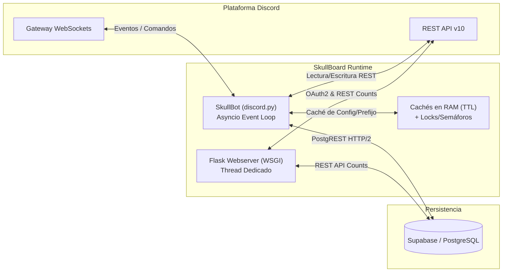

# 💀 SkullBoard — Bot de Discord & Web Dashboard

> **SkullBoard** es un bot de Discord especializado en la funcionalidad de **Starboard** (tablón de destacados basado en reacciones `💀`), diseñado bajo principios de alto rendimiento, concurrencia segura, minimización estricta de datos y una suite web integrada para OAuth2, métricas públicas y soporte legal.

---

## 📑 Tabla de Contenidos
1. [Características Principales](#-características-principales)
2. [Arquitectura del Sistema](#-arquitectura-del-sistema)
3. [Ecosistema Web & Dashboard](#-ecosistema-web--dashboard)
4. [Esquema de Base de Datos (Supabase)](#-esquema-de-base-de-datos-supabase)
5. [Variables de Entorno y Configuración](#-variables-de-entorno-y-configuración)
6. [Instalación y Despliegue](#-instalación-y-despliegue)
7. [Documentación Técnica Adicional](#-documentación-técnica-adicional)

---

## 🌟 Características Principales

- **Starboard Inteligente y Concurrente:**
  - Detección en tiempo real de reacciones `💀` mediante listeners RAW de Discord.
  - Mecanismo de **Debounce Coalescente (2.0s)**: evita ráfagas innecesarias de peticiones cuando múltiples usuarios reaccionan casi al mismo tiempo.
  - Edición en caliente sin sobrecargar la API mediante `PartialMessage` (`dest_chan.get_partial_message(sb_id)`).
  - Umbral configurable por servidor (`/set_min` o `sk!set_min`).
- **Auto-Pin Dinámico:**
  - Anclado automático de mensajes récord cuando alcanzan un umbral configurable (`/setup_pin`).
  - Detección y auto-desactivación con alerta visual si el canal alcanza el límite de 50 pins de Discord.
- **Sistema de Rankings y Estadísticas:**
  - `/top`: Top 10 histórico de mensajes más reaccionados.
  - `/top_month` y `/top_year`: Rankings filtrados por mes y año natural mediante decodificación de snowflakes de Discord (`snowflake_to_datetime`).
  - `/leaderboard`: Tabla de líderes de usuarios por calaveras totales acumuladas.
  - `/stats`: Ficha individual del usuario con enlaces directos sanitizados al mejor mensaje.
  - `/server_stats`: Métricas globales del servidor (total mensajes, calaveras, récord).
  - `/random`: Extracción de mensajes destacados aleatorios.
- **Reconciliación y Deduplicación Histórica (`/resync`):**
  - Motor de sincronización que escanea el canal del starboard, agrupa reposts por mensaje original mediante expresiones regulares, elimina duplicados/huérfanos y actualiza la base de datos protegiendo el límite global de Discord con `_GlobalRateLimiter(8)`.
- **Privacidad y Notificaciones por DM:**
  - Notificación privada al autor del mensaje cuando entra al Starboard.
  - Control granular de exclusión por usuario (`/notify off`).
  - Lista negra de canales ignorados por servidor (`/ignore`, `/unignore`, `/ignored`).
  - Minimización absoluta de datos: **nunca se almacena texto, archivos, avatares ni datos personales en la base de datos**.

---

## 🏗 Arquitectura del Sistema

El bot opera en un **único proceso de Python** que aloja dos runtimes concurrentes:



Para más detalles, consulta el documento exhaustivo [ARCHITECTURE.md](docs/ARCHITECTURE.md).

---

## 🌐 Ecosistema Web & Dashboard

El módulo `webserver.py` se ejecuta en un hilo de fondo (`threading.Thread`) sobre Flask y proporciona:

### 1. Portal Web y Landing Legal (`legal/`)
- **`GET /`**: Página de inicio (`index.html`) con resumen de características, lista de comandos destacados y diseño moderno optimizado para móvil y escritorio.
- **`GET /privacy`**: Política de Privacidad completa (redirección 301 para `/privacy.html`).
- **`GET /terms`**: Términos de Servicio oficiales del bot (redirección 301 para `/terms.html`).
- **`GET /cambios`**: Historial de cambios y novedades (redirección 301 para `/cambios.html`).
- **`GET /<filename>`**: Servidor de estáticos con Clean URLs para estilos (`styles.css`), sitemap (`sitemap.xml`) y logos (`skullboard_icon.png`).

### 2. Endpoints de API REST
- **`GET /api/stats`**:
  - Devuelve en formato JSON el recuento público en vivo de servidores configurados y mensajes destacados:
    ```json
    {
      "servers": 150,
      "highlighted": 3420
    }
    ```
  - Realiza consultas HEAD/Range ultra-ligeras a Supabase (`Content-Range: 0-0`, `Prefer: count=exact`) para no transferir filas de datos y cachea el resultado durante 60 segundos (`_stats_cache`).
  - Incluye cabeceras CORS (`Access-Control-Allow-Origin: *`) y cabeceras de caché HTTP.
- **`POST /api/contact`**:
  - Endpoint para formularios de contacto externos con integración directa al servicio de correo **Resend API**.
  - **Seguridad:** Trampa anti-bots (*honeypot* `website`), rate-limiting por IP en memoria (`_contact_last`, máx 1 mensaje cada 30 segundos), sanitización HTML de entradas y soporte para preflight CORS `OPTIONS`.

### 3. Integración Discord Linked Roles (OAuth2)
- **`GET /verify`**: Genera un identificador criptográfico anti-CSRF (`secrets.token_urlsafe(24)`) con expiración de 10 minutos y redirige al flujo de consentimiento OAuth2 de Discord (`identify role_connections.write`).
- **`GET /callback`**: Valida el token `state`, intercambia el `code` por un `access_token`, valida que el usuario sea el `BOT_OWNER_ID` y registra los metadatos `{ "is_owner": true }` en la API de Discord para otorgar el rol verificado.
- **`register_metadata()`**: Registra la definición del esquema de Linked Roles en Discord al inicializar el servidor.

---

## 🗄 Esquema de Base de Datos (Supabase)

El sistema utiliza 4 tablas principales en PostgreSQL:

| Tabla | Clave Primaria | Columnas | Propósito |
| :--- | :--- | :--- | :--- |
| **`settings`** | `guild_id` | `skullboard_channel_id`, `min_skulls`, `prefix`, `pin_threshold` | Configuración por servidor. |
| **`tracked_messages`** | `message_id` | `skullboard_message_id`, `skull_count`, `author_id`, `guild_id` | Mapeo 1:1 entre original y repost en el Starboard. |
| **`ignored_channels`** | `(guild_id, channel_id)` | `guild_id`, `channel_id` | Canales excluidos del Starboard. |
| **`notify_settings`** | `(guild_id, user_id)` | `guild_id`, `user_id`, `enabled` | Preferencias de recepción de DMs por usuario. |

---

## 🔑 Variables de Entorno y Configuración

Crea un archivo `.env` o configura las siguientes variables en tu plataforma de despliegue:

```env
# Discord Configuration
DISCORD_TOKEN="tu_token_de_bot_de_discord"
DISCORD_APPLICATION_ID="1367463352774955059"
DISCORD_CLIENT_SECRET="tu_client_secret_oauth2"
DISCORD_REDIRECT_URI="https://tu-dominio.com/callback"
BOT_OWNER_ID="561225979389804544"

# Supabase Database
SUPABASE_URL="https://tu-proyecto.supabase.co"
SUPABASE_SERVICE_ROLE_KEY="tu_clave_de_servicio_supabase"

# Dashboard OAuth (solo backend Render/local; nunca Vercel)
SKULLBOARD_ENV="production"
SKULLBOARD_SESSION_ENCRYPTION_KEY="tu_clave_fernet_estable"
SKULLBOARD_DASHBOARD_REDIRECT_URI="https://skullboard.vercel.app/dashboard"
WEB_ALLOWED_ORIGINS="https://skullboard.vercel.app"

# Webserver & Contact Form (Opcional)
RESEND_API_KEY="re_tu_clave_de_resend"
```

`SKULLBOARD_SESSION_ENCRYPTION_KEY` debe ser una clave Fernet estable de 32 bytes en base64 URL-safe. No pongas una clave de Discord, Supabase ni Vercel. Para crearla y guardarla como variable de usuario en Windows sin mostrarla en consola:

```powershell
$skullboardKey = python -c "from cryptography.fernet import Fernet; print(Fernet.generate_key().decode())"
[Environment]::SetEnvironmentVariable("SKULLBOARD_SESSION_ENCRYPTION_KEY", $skullboardKey, "User")
Remove-Variable skullboardKey
```

---

## 🚀 Instalación y Despliegue

### Requisitos Previos
- Python 3.10 o superior
- Proyecto configurado en Supabase (PostgreSQL)
- Aplicación registrada en el [Portal de Desarrolladores de Discord](https://discord.com/developers/applications) con los intents privilegiados activados:
  - `Message Content Intent`
  - `Server Members Intent`

### Pasos de Instalación Local
```bash
# 1. Clonar el repositorio
git clone https://github.com/tu-usuario/skullboard.git
cd skullboard

# 2. Crear y activar entorno virtual
python -m venv venv
# En Windows:
venv\Scripts\activate
# En Linux/macOS:
source venv/bin/activate

# 3. Instalar dependencias
pip install -r requirements.txt

# 4. Iniciar el bot y el servidor web
python main.py
```

---

## 📚 Documentación Técnica Adicional

- 📐 **[ARCHITECTURE.md](docs/ARCHITECTURE.md)**: Arquitectura detallada, diagramas de secuencia, política de sincronización y análisis de rendimiento.
- 📖 **[COMMANDS.md](docs/COMMANDS.md)**: Manual exhaustivo de todos los comandos de texto, slash commands y comandos administrativos.
- 🏛️ **[SYSTEM_CONTEXT.md](docs/SYSTEM_CONTEXT.md)**: Documento maestro de gobernanza técnica, invariantes arquitectónicas y reglas de desarrollo.
- 🧭 **[MCP_AND_SKILLS.md](docs/MCP_AND_SKILLS.md)**: Manual maestro de servidores MCP, Agent Skills y protocolo `/grill-me` + `/goal` para tareas complejas.
