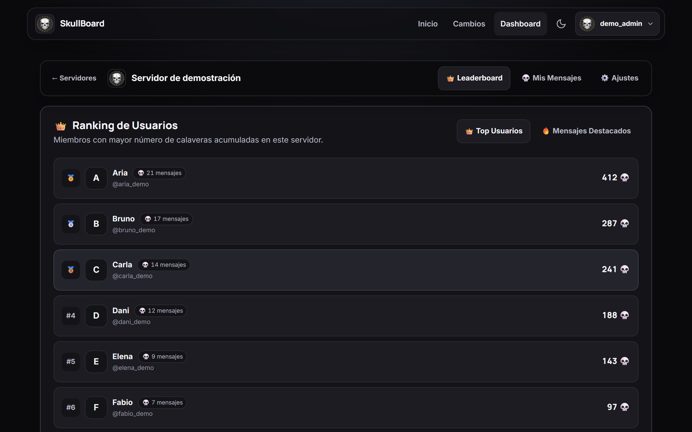
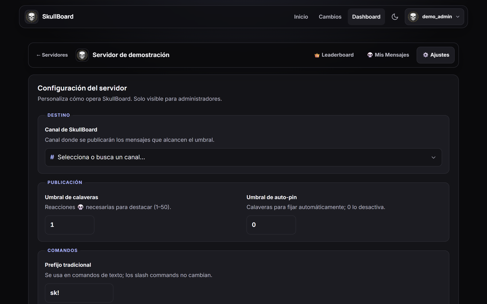

  

  <a href="https://discord.com/oauth2/authorize?client_id=1367463352774955059&permissions=277025508352&scope=bot+applications.commands"><b>Añadir a Discord</b></a>
  &nbsp;·&nbsp;
  <a href="https://skullboard.vercel.app">Web</a>
  &nbsp;·&nbsp;
  <a href="https://skullboard.vercel.app/dashboard">Dashboard</a>
  &nbsp;·&nbsp;
  <a href="docs/caso-tecnico.md">Caso técnico</a>
  &nbsp;·&nbsp;
  <a href="README.en.md">English</a>

  

SkullBoard es un bot de Discord para comunidades que ya usan la reacción 💀 como aplauso. Cuando un mensaje reúne suficientes calaveras, el bot lo copia en un canal propio: el tablón de honor del servidor. También lleva la cuenta. Sabe quién acumula más, cuáles son los mensajes más votados del mes y del año, y cuál es el récord actual.

Empezó en mayo de 2025 como proyecto personal y sigue en marcha. Este repositorio es su escaparate: explica qué hace el bot y cómo está construido. El código fuente es privado.

## Cómo funciona

Alguien reacciona con 💀 a un mensaje. Si el recuento alcanza el umbral que ha fijado el servidor, SkullBoard lo publica en el canal de destacados con su autor, su texto, la imagen si la hay y un enlace al original. Cada calavera nueva actualiza esa misma publicación en lugar de crear otra, y el marcador pasa de 💀 a ☠️ cuando se duplica el umbral. Si el mensaje original se borra, la copia desaparece también.

## Qué incluye

- Tablón automático, con auto-pin opcional para fijar los mensajes que llegan a un umbral más alto.
- Rankings por servidor: usuarios con más calaveras, mensajes más votados y tops del mes y del año.
- Configuración propia en cada servidor: canal de destino, umbral, prefijo de comandos y canales que no cuentan.
- Aviso por mensaje directo al autor cuando su mensaje entra en el tablón. Cada usuario puede desactivarlo con `/notify`.
- Dashboard web con inicio de sesión de Discord, para consultar rankings y, si eres administrador, cambiar la configuración sin escribir comandos.
- Comandos slash y de texto: 22 en total, [listados en la web](https://skullboard.vercel.app/#comandos).

SkullBoard guarda identificadores y contadores. No guarda el texto de los mensajes. Los detalles están en la [política de privacidad](https://skullboard.vercel.app/privacy).

## Dashboard

<table>
  <tr>
    <td width="50%"></td>
    <td width="50%"></td>
  </tr>
</table>

Capturas con datos de demostración. A la izquierda, el ranking de un servidor. A la derecha, los ajustes, que solo ven los administradores.

## Empezar

1. [Invita el bot](https://discord.com/oauth2/authorize?client_id=1367463352774955059&permissions=277025508352&scope=bot+applications.commands) a tu servidor.
2. Elige el canal de destacados con `/set_channel`.
3. Ajusta cuántas calaveras hacen falta con `/set_min`. Por defecto basta una.

Con eso ya funciona. `/setup_pin`, `/ignore` y `/prefix` son opcionales, y todo se puede cambiar también desde el [dashboard](https://skullboard.vercel.app/dashboard).

## Detrás del bot

Un bot que reacciona a eventos parece sencillo hasta que veinte personas reaccionan al mismo mensaje en dos segundos. 

- Ráfagas de reacciones. Cada mensaje tiene un temporizador de dos segundos que se reinicia con cada reacción, y un lock que impide dos comprobaciones simultáneas. Veinte reacciones seguidas producen una sola comprobación.
- Límites de Discord. Las operaciones masivas, como reconciliar un tablón entero con `/resync`, pasan por un limitador global de 8 peticiones por segundo para todo el proceso, así que lanzarlas en varios servidores a la vez no agota el cupo del bot.
- Sesiones del dashboard. El navegador recibe una cookie opaca. Los tokens de Discord se cifran en el servidor y nunca llegan al cliente. El `state` de OAuth se guarda como HMAC y solo sirve una vez.
- Base de datos cerrada por defecto. Las tablas tienen RLS sin políticas públicas. Solo el backend puede leerlas.
- Pruebas. Hay comprobaciones estáticas, pruebas de autenticación y un entorno local que ejecuta el backend real con Discord y la base de datos simulados, detrás de un proxy equivalente al de producción. Un navegador real recorre el login, los ajustes y el cierre de sesión.

El [caso técnico](docs/caso-tecnico.md) cuenta con más detalle cuatro problemas concretos y cómo se resolvieron.

## Enlaces

[Web](https://skullboard.vercel.app) · [Dashboard](https://skullboard.vercel.app/dashboard) · [Historial de cambios](https://skullboard.vercel.app/cambios) · [Términos](https://skullboard.vercel.app/terms) · [Privacidad](https://skullboard.vercel.app/privacy) · [Contacto](https://skullboard.vercel.app/#contacto)

  Proyecto de GlobalFerociouS · © 2025–2026 SkullBoard. Todos los derechos reservados

