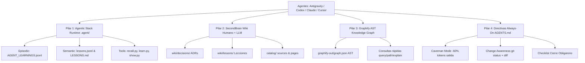

# Arquitectura del Sistema de Memoria Compartida, Orquestación y Conexión Multi-IA

Este documento describe la arquitectura técnica, historia de evolución y funcionamiento del sistema de memoria compartida, orquestación y reducción radical de consumo de tokens entre herramientas de IA (**Google Antigravity**, **OpenAI Codex**, **Claude Code**, **Cursor** y **OpenCode**) operando sobre este repositorio y sus proyectos hermanos.

---

## 1. El Problema Raíz: La Fricción Multi-Agente

### 1.1 El Contexto Original
En flujos de trabajo avanzados de desarrollo asistido por IA (con decenas de miles de turnos de conversación y miles de millones de tokens consumidos), emergen tres problemas críticos:
1. **Amnesia Cruzada entre Herramientas**: Cada herramienta (Codex, Antigravity, Claude Code) tiene su propio almacén de contexto. Al saltar de una a otra para aprovechar sus fortalezas específicas, el usuario se ve obligado a re-explicar la arquitectura, las decisiones pasadas, las normas de estilo y las trampas ya resueltas.
2. **Exploración Ciega y Consumo Desbocado de Tokens**: Los agentes tradicionales ejecutan búsquedas masivas (grep, find, o lectura completa de archivos fuente de 500-2000 líneas). Esto consume entre 30.000 y 80.000 tokens por turno, agotando las ventanas de cuota (límites de 5 horas o cuotas diarias de API) en apenas dos o tres auditorías.
3. **Desincronización de Estado entre Editores**: Cuando un agente o editor modifica un archivo, otro agente en una sesión nueva asume el estado que tenía en su conocimiento previo, produciendo código desalineado, sobreescritura de cambios y regresiones silenciosas.

---

## 2. Los Cuatro Pilares del Sistema Unificado

Para erradicar estos problemas, el sistema se estructura sobre cuatro pilares interconectados:



---

### Pilar 1: Agentic Stack (.agent/) — El Cerebro de Ejecución Portátil
Originado en la suite de *agentic-stack* (codejunkie99/agentic-stack), este directorio actúa como el motor de memoria en tiempo de ejecución:
- **Memoria Episódica (.agent/memory/episodic/AGENT_LEARNINGS.jsonl)**: Registro cronológico de acciones, intenciones y desenlaces generado mediante .agent/tools/memory_reflect.py.
- **Memoria Semántica (.agent/memory/semantic/lessons.jsonl y LESSONS.md)**: Base de datos estructurada de reglas y patrones destilados. LESSONS.md nunca se edita a mano: se compila automáticamente al graduar lecciones.
- **Ciclo de Sueño y Graduación (auto_dream.py, candidates/, graduate.py, learn.py)**:
  - Las lecciones candidatas se agrupan por vocabulario común y saliencia.
  - Para enseñar una regla inmediata: python .agent/tools/learn.py "<regla>" --rationale "<por qué>".
- **Recall Proactivo (python .agent/tools/recall.py "<intención>")**:
  - **Obligatorio** antes de tareas de deploy, migración, base de datos, timestamps, debug o refactor.
  - Realiza matching léxico sobre la base de lecciones aceptadas e inyecta únicamente la lección relevante (menos de 100 tokens), evitando leer historiales pasados.
- **Dashboard de Estado (python .agent/tools/show.py)**:
  - Proporciona una vista rápida en terminal de episodios, estado de lecciones, candidatos y salud de skills.

---

### Pilar 2: SecondBrain (SecondBrain/) — La Wiki Curada y Auditada
A diferencia del runtime de .agent/, SecondBrain/ es una base de conocimiento legible tanto por humanos como por agentes, estructurada como una wiki de arquitectura:
- **Estructura Estándar**:
  ```text
  SecondBrain/
  ├── README.md               # Explicación del almacén
  ├── AGENTS.md               # Contrato de operación para agentes
  ├── config/                 # sources.yaml, projects.yaml, routing.yaml, policy.md
  ├── catalog/                # sources.jsonl, pages.jsonl, exclusions.jsonl
  └── wiki/
      ├── index.md            # Índice maestro de temas
      ├── projects/           # Resumen y límites del proyecto
      ├── decisions/          # Architectural Decision Records (ADRs: 001-..., 002-...)
      ├── lessons/            # Lecciones de bugs y comportamiento de APIs externas
      ├── workflows/          # Procedimientos probados (deploy, change awareness)
      └── operations/         # Manuales de mantenimiento, consulta e ingesta
  ```
- **Principio de Localidad (Por Proyecto, No Global)**:
  - Inicialmente se intentó apuntar a un SecondBrain global en C:\Users\Fer\SecondBrain.
  - **Lección aprendida**: Un almacén global mezcla reglas de bots de Discord con proyectos personales o scripts de automatización. Cada repositorio DEBE tener su propio SecondBrain/ local en la raíz.
- **Trazabilidad y No Contaminación**:
  - Credenciales, tokens y salidas de depuración crudas están expresamente prohibidos en el catálogo (exclusions.jsonl).
  - Todo registro arquitectónico importante se escribe como un ADR en SecondBrain/wiki/decisions/ y se enlaza en wiki/index.md.

---

### Pilar 3: Graphify (graphify-out/) — Inteligencia de Grafo de Código
Graphify sustituye las búsquedas masivas de texto por navegación basada en el Árbol de Sintaxis Abstracta (AST):
- **Cero Costo de Inferencia para Mapear**: python -m graphify extract . --code-only o graphify update . analiza el código localmente mediante parsers de sintaxis, identificando clases, funciones, métodos y dependencias en segundos.
- **Consultas Quirúrgicas**:
  - python -m graphify query "<pregunta>": Extrae el subgrafo relevante con límite de tokens (--budget 400-600).
  - python -m graphify path "SimboloA" "SimboloB": Revela la cadena de llamadas exacta entre dos componentes.
  - python -m graphify explain "ClaseOFuncion": Muestra el contrato del símbolo y sus consumidores inmediatos.
- **Hooks de Sincronización Automática**:
  - Githooks (post-commit, post-checkout) actualizan el grafo tras cada commit sin intervención del desarrollador.

---

### Pilar 4: Directivas Always-On y Sincronización (AGENTS.md)
Las reglas no dependen de la memoria volátil del chat ni de que el usuario las repita; están consolidadas en AGENTS.md (y espejadas en GEMINI.md, CLAUDE.md, .cursor/rules/):
1. **Caveman Style Always-On**:
   - Terse, directo, técnico, sin rodeos ni cortesías ("*Bug in auth middleware. Fix:*").
   - Ahorro de un 60-75% de tokens de salida respecto a respuestas verborrágicas estándar.
2. **Change Awareness Rule**:
   - Antes de iniciar cualquier tarea no trivial, el agente DEBE ejecutar git status y git diff --stat.
   - Si otro editor (Cursor, Codex, Antigravity) modificó archivos, el agente detecta el diff y sincroniza su comprensión antes de proponer cambios.
3. **Checklist de Cierre Obligatorio**:
   - 1. Verificación y pruebas locales (safeguards_test.py, py_compile, tests unitarios).
   - 2. Cierre de memoria: Registrar ADR en SecondBrain/wiki/decisions/ y graduar lecciones con python .agent/tools/learn.py.
   - 3. Sincronización de Graphify (python -m graphify extract . --code-only).
   - 4. Commit y Push automático a origin/main (salvo orden expresa de pausa).

---

## 3. Retos Técnicos Críticos Resueltos en la Construcción

### 3.1 La Trampa de Codificación Windows (CP1252 vs UTF-8)
- **Problema**: En sistemas Windows, Python inicializa sys.stdout con la página de códigos local de Windows (típicamente cp1252). Las herramientas de Agentic Stack emitían caracteres tipográficos como → (\u2192), cajas ANSI o em-dashes —.
- **Consecuencia**: recall.py, graduate.py y show.py fallaban silenciosamente con UnicodeEncodeError: 'charmap' codec can't encode character '\u2192', impidiendo que los agentes graduaran o recuperaran lecciones.
- **Solución Definitiva**: Inyección de reconfiguración segura al inicio de cada script en .agent/tools/:
  ```python
  if hasattr(sys.stdout, "reconfigure"):
      sys.stdout.reconfigure(encoding="utf-8", errors="replace")
  if hasattr(sys.stderr, "reconfigure"):
      sys.stderr.reconfigure(encoding="utf-8", errors="replace")
  ```

### 3.2 Concurrencia fcntl en Windows
- **Problema**: Agentic Stack utiliza primitivas POSIX fcntl para bloqueo de escritura concurrente en lessons.jsonl.
- **Comportamiento**: En Windows fcntl no existe de forma nativa. Se emite un RuntimeWarning no bloqueante pero seguro para entornos de desarrollo personal monousuario.

### 3.3 Ambigüedad entre docs/DECISIONS.md y SecondBrain/wiki/
- **Problema**: Las directivas antiguas indicaban genéricamente "registra en docs/DECISIONS.md". Los agentes asumían que ese único archivo era todo el SecondBrain y nunca creaban ni consultaban SecondBrain/wiki/decisions/.
- **Solución**: Homologación explícita: SecondBrain/wiki/decisions/<id>-<tema>.md es la fuente estructurada canónica, enlazada en SecondBrain/wiki/index.md y resumida en docs/DECISIONS.md.

### 3.4 Migración de Workflows Planos a Skills
- **Problema**: Los antiguos archivos .agents/workflows/*.md eran prompts estáticos sin capacidades de descubrimiento semántico ni subcomandos.
- **Solución**: Migración automática (`/migrate-workflows`), archivando los `.md` legados a `.md.bak` y adoptando skills completas (`.agents/skills/<name>/SKILL.md`) con slash commands de primer nivel.

---

## 4. Comparativa: Supermemory vs Agentic Stack

| Criterio | Supermemory | Agentic Stack + SecondBrain |
| :--- | :--- | :--- |
| **Enfoque principal** | Captura automática de hechos, preferencias y memoria temporal | Segundo cerebro estructurado, ADRs, lecciones destiladas y protocolos |
| **Almacenamiento** | Nube (cloud-first) con opción local | 100% local-first en archivos Markdown y JSONL auditables |
| **Integración de código** | Plugins para IDEs y captura de contexto conversacional | Grafo de dependencias AST (Graphify) + adaptadores universales |
| **Control de versiones** | Gestionado por la plataforma | Versionado estándar en Git (ADRs en markdown rastreables) |
| **Sinergia ideal** | Hechos de usuario y preferencias cross-session | Arquitectura, decisiones técnicas por repositorio y protocolos de equipo |

---

## 5. Estrategia de Modelos y Auditorías de Mínimo Consumo

### 5.1 Regla de Selección de Modelos (Pirámide de Coste)
1. **Tier 1 (Exploración / Rutina / Setup)**: Modelos ligeros (`gpt-5.4-mini`, `gpt-5.6-luna` medium, `Gemini Flash`).
   - Usar para: Pruebas de conexión, escaneos de memoria, consultas de grafo y modificaciones de 1-2 archivos.
2. **Tier 2 (Desarrollo / Orquestación Principal)**: Modelo estándar de alta capacidad (`gpt-5.6-luna` max).
   - Usar para: Implementaciones de funciones completas, refactorizaciones y lógica central.
3. **Tier 3 (Revisión Crítica / Seguridad)**: Modelo de máximo razonamiento (`gpt-6-astra` low).
   - Usar para: Revisiones finales de vulnerabilidades o cambios de infraestructura de alto riesgo.
   - **Regla Invariable**: Nunca usar Astra como root orchestrator. Máximo 3 hilos de subagente por sesión.

### 5.2 Plantilla de Auditoría sin Consumir la Cuota de 5 Horas
Para auditar un subsistema sin devorar tokens:
```text
Caveman ON. Objetivo: encontrar mejoras reales de alto impacto, no reescribir todo.
1. Ejecuta Change Awareness (git status + diff).
2. Usa Graphify para ubicar la arquitectura de [zona específica]. No leas archivos masivos todavía.
3. Inspecciona quirúrgicamente:
   - Manejo de eventos / concurrencia / bloqueos
   - Consultas a base de datos (posibles N+1, índices)
   - Permisos y validación de entrada
4. Reporta únicamente hallazgos concretos: ubicación exacta, impacto y corrección mínima.
```