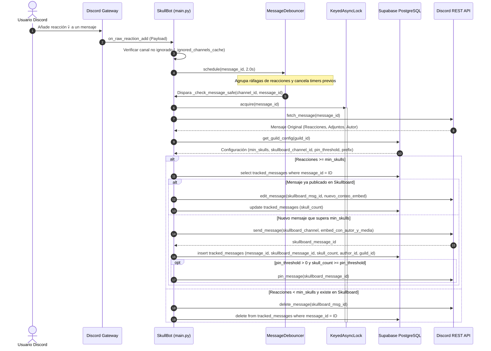
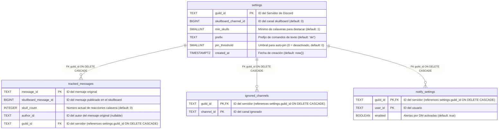

# 🏛️ SYSTEM_CONTEXT.md — Documento Maestro de Arquitectura y Gobernanza Técnica

> **ESTADO DEL DOCUMENTO:** VIVO / PRODUCCIÓN  
> **VERSIÓN:** 2.5.0 (Dashboard Web OAuth2, AutoShardedBot, Alertas Webhook y PWA)  
> **FECHA DE ÚLTIMA ACTUALIZACIÓN:** 1 de septiembre de 2026  
> **PROPIETARIO TÉCNICO:** GlobalFerociouS (ID: `561225979389804544`)  
> **APLICACIÓN / BOT ID:** `1367463352774955059`  
> **DOMINIOS OFICIALES:**  
> • Frontend & Dashboard: https://skullboard.vercel.app/  
> • Backend & API REST: https://skullboard-fqf1.onrender.com  
> • Soporte & Contacto: globalsupportpyt@gmail.com

---

## 1. 🛑 PROTOCOLO OBLIGATORIO DE GOBERNANZA PARA AGENTES IA & REGLAS DE ORO

> [!CAUTION]
> ### CLÁUSULA DE LECTURA Y CONFORMIDAD OBLIGATORIA
> Todo agente de Inteligencia Artificial (Claude, ChatGPT, Gemini, Copilot, Cursor, Windsurf, Antigravity, etc.) y cualquier desarrollador humano **DEBE LEER ÍNTEGRAMENTE este documento antes de planificar, sugerir, refactorizar o ejecutar cualquier modificación** en la base de código.
> 
> **Queda estrictamente prohibido inventar comandos, columnas inexistentes en base de datos o introducir dependencias innecesarias.**

### 1.1. Decálogo de Invariantes Arquitectónicas (Reglas de Oro)

1. **Gestión de Concurrencia Inmune a Cancelaciones (`KeyedAsyncLock`):**
   Cualquier operación sobre un mensaje (`_check_locks`) o servidor (`_resync_locks`) debe usar `async with await lock.acquire(key):`. Nunca instanciar locks manuales sin decremento de referencias atómico en caso de cancelación de corrutinas (`asyncio.CancelledError`).
2. **Prohibición de Consultas $O(N)$ en Memoria:**
   Las estadísticas globales, leaderboards y rankings temporales se ejecutan **exclusivamente mediante Funciones RPC en PostgreSQL** (`get_guild_leaderboard`, `get_guild_server_stats`, `get_top_periodo`, `get_random_tracked_message`). Nunca descargar tablas enteras a memoria para agregarlas en bucles de Python.
3. **Resiliencia Obligatoria en Base de Datos (`@db_retry`):**
   Toda llamada a Supabase (`db_select`, `db_insert`, `db_update`, `db_upsert`) debe estar protegida con el decorador `@db_retry` para mitigar microcortes con *exponential backoff* y *jitter*.
4. **Desacoplamiento Estricto de I/O en Flask (`webserver.py`):**
   Las peticiones a APIs externas o bases de datos (Supabase, Resend, Discord) **nunca deben ejecutarse dentro de bloques `with _stats_lock:` o locks de memoria**. Los locks multihilo solo protegen estructuras en RAM.
5. **Clean URLs y Cero Extensiones `.html`:**
   En todo el ecosistema (HTML, JS, Python, Vercel, Flask, Discord Embeds), las URLs deben ser limpias (`/`, `/privacy`, `/terms`, `/cambios`). Vercel y Flask redirigen con 301/308 permanente cualquier acceso con `.html`.
6. **No Retención de Contenido de Mensajes (Privacidad Absoluta):**
   Solo se almacenan en base de datos IDs numéricas (snowflakes) y contadores enteros. **Nunca guardar el texto, imágenes o adjuntos de los mensajes**.
7. **Control de Acceso y Permisos de Discord:**
   Los comandos administrativos deben exigir `@commands.has_permissions(administrator=True)` y validación en tiempo de ejecución (`_is_admin_or_deny()`). `sk!reset` y `/reset` son exclusivos del **Server Owner** (`interaction.user.id == interaction.guild.owner_id` o `ctx.author.id == ctx.guild.owner_id`).
8. **Sanitización y Anti-Inyección (CRLF, XSS, Markdown):**
   Todo texto proveniente de usuarios (nombres de servidor, emails, mensajes de contacto) debe ser sanitizado con `re.sub(r'[\r\n]+', ' ', ...)` y `html.escape()` antes de procesarse o enviarse por correo.
9. **Accesibilidad Web (WCAG AA):**
   Todos los componentes interactivos del frontend deben contar con soporte de teclado (`Tab`, `Enter`, `Espacio`), roles semánticos (`role="button"`), estados `aria-expanded` y contraste de texto $\ge 4.5:1$.
10. **Principio de Simplicidad Radical (Ponytail):**
    Preferir siempre la biblioteca estándar de Python y funciones nativas de PostgreSQL antes de añadir dependencias o capas de abstracción innecesarias.
11. **Registro Obligatorio en Historial de Cambios (`legal/cambios.html`):**
    Cualquier modificación, nueva funcionalidad, refactorización de interfaz, ajuste en comandos o parche de seguridad/rendimiento **DEBE registrarse inmediatamente en `legal/cambios.html`** dentro del Timeline de cambios con su fecha, número de versión, badges de categoría (`ui`, `new`, `sec`, `fix`) y desglose conciso.
12. **Protocolo para Tareas Complejas (`/grill-me` & `/goal`) y Catálogo MCP/Skills:**
    Para cambios arquitectónicos de gran envergadura o refactorizaciones profundas, se debe emplear **`/grill-me`** (entrevista técnica previa) y **`/goal`** (ejecución autónoma con validación continua). El catálogo de habilidades y herramientas externas se rige por [**`docs/MCP_AND_SKILLS.md`**](MCP_AND_SKILLS.md).

---

## 2. 🏗️ TOPOLOGÍA DEL SISTEMA Y ARQUITECTURA DETALLADA

### 2.1. Desglose del Stack Tecnológico

```mermaid
graph TD
    subgraph Discord_Cloud["Plataforma Discord"]
        Client["Clientes Discord (Móvil / Desktop / Web)"]
        Gateway["Discord Gateway (WebSockets v10)"]
        DiscordREST["Discord REST API v10"]
    end

    subgraph Render_PaaS["Backend Host (Render Cloud)"]
        subgraph Python_Process["Proceso Python Único"]
            subgraph Main_Thread["Hilo Principal: Asyncio Event Loop"]
                Bot["SkullBot (discord.ext.commands.AutoShardedBot)"]
                Tree["GuildOnlyTree (Slash Commands)"]
                Debouncer["MessageDebouncer (Generacional 2.0s)"]
                MsgLocks["KeyedAsyncLock (_check_locks / _resync_locks)"]
                DBSync["DB Wrappers (@db_retry)"]
                RAM_Cache["Cachés en RAM (TTL 120s - 300s)"]
            end
            
            subgraph Worker_Thread["Hilo Secundario: Flask WSGI (threaded=True)"]
                FlaskServer["Flask App (PORT $PORT / 8080)"]
                StatsCache["_stats_cache (TTL 60s)"]
                ContactLRU["_contact_last (LRU Throttling)"]
                OAuthHandler["OAuth2 Manager (Anti-CSRF State)"]
            end
        end
    end

    subgraph Vercel_Edge["Frontend & Landing (Vercel Edge Network)"]
        VercelCDN["Vercel Static Hosting (Clean URLs, 308 Redirects)"]
        DashboardUI["Dashboard / Web (legal/index.html, styles.css)"]
        DocPages["Páginas Legales (/privacy, /terms, /cambios)"]
    end

    subgraph Data_Layer["Capa de Persistencia & Cloud Services"]
        SupabasePostgres[("Supabase PostgreSQL 15+\n(RPCs nativas, Índices de alto rendimiento)")]
        ResendAPI["Resend Email API (Transaccional)"]
    end

    %% Relaciones
    Client -->|Reacciona con 💀 / Envía Comandos| Gateway
    Gateway -->|RAW Events (Add/Remove Reaction, Message Delete)| Bot
    Bot -->|Programar Verificación| Debouncer
    Debouncer -->|Ejecutar tras 2.0s| MsgLocks
    MsgLocks -->|Consultas con Retry| DBSync
    DBSync <-->|HTTP/2 PostgREST / RPCs| SupabasePostgres
    MsgLocks -->|Publicar / Editar Embeds / Auto-Pin| DiscordREST
    
    Client -->|Navega a skullboard.vercel.app| VercelCDN
    VercelCDN --> DashboardUI
    DashboardUI -->|GET /api/stats (AbortController 8s)| FlaskServer
    DashboardUI -->|POST /api/contact (AbortController 12s)| FlaskServer
    FlaskServer -->|Envío de Email| ResendAPI
    FlaskServer -->|Consulta periódica de conteos| SupabasePostgres
```

---

### 2.2. Diagrama de Secuencia: Flujo de Vida de una Reacción 💀



---

## 3. 🗄️ MODELO DE DATOS, PERSISTENCIA Y RPCs DE POSTGRESQL

### 3.1. Diagrama Entidad-Relación (ERD Exacto de Supabase)



### 3.2. Catálogo de Índices de Alto Rendimiento

1. `idx_tracked_messages_guild_author_skulls` en `(guild_id, author_id, skull_count)`: Acelera agregaciones y conteos por usuario.
2. `idx_tracked_messages_guild_msgid_skulls` en `(guild_id, (message_id::BIGINT), skull_count DESC)`: Acelera filtros cronológicos.
3. `idx_tracked_messages_sb_id` en `(skullboard_message_id)`: Acelera búsquedas de mensajes borrados de $O(N)$ a $O(1)$.
4. `idx_notify_settings_disabled` en `(guild_id, user_id)` con filtro `WHERE enabled = false`: Optimiza la carga de la caché de notificaciones al inicio.

---

### 3.3. Especificación Técnica de Funciones Almacenadas (PostgreSQL RPCs)

#### 1. `get_guild_leaderboard(p_guild_id TEXT, p_limit INT DEFAULT 10)`
* **Firma de Retorno:** `TABLE (author_id TEXT, total_skulls BIGINT, message_count BIGINT)`
* **Seguridad:** `SECURITY INVOKER`, límites forzados entre 1 y 100 con `LEAST(GREATEST(p_limit, 1), 100)`.
* **Comportamiento:** Agrega por autor ordenando por `total_skulls DESC, author_id ASC`.

#### 2. `get_guild_server_stats(p_guild_id TEXT)`
* **Firma de Retorno:** `TABLE (total_messages BIGINT, total_skulls BIGINT, record_count INT, top_author_id TEXT, top_author_skulls BIGINT)`
* **Comportamiento:** Si el servidor no tiene mensajes registrados, devuelve ceros limpios `(0, 0, 0, NULL, 0)` evitando `TypeError` en Python.

#### 3. `get_random_tracked_message(p_guild_id TEXT)`
* **Firma de Retorno:** `TABLE (message_id TEXT, skullboard_message_id BIGINT, skull_count INT, author_id TEXT, guild_id TEXT)`
* **Comportamiento:** Selecciona 1 fila aleatoria con `ORDER BY random() LIMIT 1`.

#### 4. `get_top_periodo(p_guild_id TEXT, p_min_snowflake BIGINT, p_limit INT DEFAULT 10)`
* **Firma de Retorno:** `TABLE (message_id TEXT, skullboard_message_id BIGINT, skull_count INT, author_id TEXT)`
* **Comportamiento:** Filtra mensajes por snowflake con regex seguro `message_id ~ '^[0-9]{15,21}$'`.

---

## 4. 📜 CATÁLOGO COMPLETO DE COMANDOS Y API ENDPOINTS (100% REAL)

### 4.1. Comandos de Discord (Slash & Prefijo)

| Comando Slash | Comando Prefijo (Aliases) | Categoría | Permisos Requeridos | Parámetros y Descripción |
| :--- | :--- | :--- | :--- | :--- |
| `/ajustes` | `sk!ajustes` (`settings`) | General | Todos | Muestra un embed con la configuración actual del servidor. |
| `/prefix` | `sk!prefix` (`set_prefix`) | Admin | Administrador | `nuevo_prefijo: str` (máx 10 caracteres). Cambia el prefijo de texto. |
| `/set_channel`| `sk!set_channel` (`channel`) | Admin | Administrador | `channel: TextChannel`. Configura el canal de publicación del skullboard. |
| `/set_min` | `sk!set_min` (`min`) | Admin | Administrador | `cantidad: int` ($\ge 1$). Fija el mínimo de calaveras para destacar. |
| `/ping` | `sk!ping` | General | Todos | Muestra la latencia del bot en milisegundos y estado de conexión. |
| `/invite` | `sk!invite` | General | Todos | Genera el enlace de invitación oficial para añadir el bot. |
| `/dashboard` | `sk!dashboard` (`web`, `panel`) | General | Todos | Envía un embed con botones interactivos hacia la web, TOS, privacidad y novedades. |
| `/help` | `sk!help` (`ayuda`, `comandos`) | General | Todos | Menú de ayuda interactivo y paginado con botones. |
| `/top` | `sk!top` | Calaveras | Todos | Top 10 mensajes más reaccionados históricamente en el servidor. |
| `/random` | `sk!random` | Calaveras | Todos | Muestra un mensaje aleatorio que esté publicado en el skullboard. |
| `/stats` | `sk!stats` (`estadisticas`)| Calaveras | Todos | `usuario: Member = None`. Estadísticas y mejor mensaje del usuario. |
| `/ignore` | `sk!ignore` | Admin | Administrador | `canal: TextChannel`. Añade un canal a la lista negra para no contar calaveras. |
| `/unignore` | `sk!unignore` | Admin | Administrador | `canal: TextChannel`. Reincorpora un canal previamente ignorado. |
| `/ignored` | `sk!ignored` | Calaveras | Todos | Lista todos los canales ignorados del servidor. |
| `/notify` | `sk!notify` | General | Todos | `estado: Choice['on', 'off'] = None`. Activa/desactiva avisos por DM al entrar al skullboard. |
| `/setup_pin` | `sk!setuppin` (`setup_pin`) | Admin | Administrador | `umbral: int` ($\ge 0$). Fija calaveras para auto-pin de mensajes ($0 = desactivar$). |
| `/leaderboard`| `sk!leaderboard` (`lb`, `topusers`)| Rankings | Todos | Top 10 usuarios con más calaveras acumuladas en el servidor. |
| `/server_stats`| `sk!serverstats` (`sstats`, `server_stats`)| Rankings | Todos | Estadísticas globales: total de mensajes, calaveras, récord y MVP. |
| `/top_month` | `sk!topmonth` (`monthly`, `top_month`)| Rankings | Todos | Top mensajes destacados publicados en el mes en curso. |
| `/top_year` | `sk!topyear` (`yearly`, `top_year`)| Rankings | Todos | Top mensajes destacados publicados en el año en curso. |
| `/resync` | `sk!resync` (`sync`) | Admin | Administrador | Re-escanea el canal skullboard, sincroniza conteos y purga duplicados. |
| `/reset` | `sk!reset` (hidden) | Admin | **Server Owner** | Restablece la configuración del servidor y borra los registros rastreados. |
| `—` | `sk!announce` (hidden) | Owner | **Bot Owner** | Envía un comunicado oficial a todos los canales skullboard activos. |
| `—` | `sk!editannounce` (hidden) | Owner | **Bot Owner** | `message_id: int`. Edita el comunicado enviado en todos los servidores. |
| `—` | `sk!servers` (hidden) | Owner | **Bot Owner** | Muestra la lista de servidores donde el bot está presente. |
| `—` | `sk!serverinfo` (hidden) | Owner | **Bot Owner** | `guild_id: int`. Muestra información técnica detallada de un servidor. |
| `—` | `sk!backfill` (hidden) | Owner | **Bot Owner** | Reconcilia y migra IDs de mensajes antiguos desde el historial. |

---

### 4.2. API REST del Servidor Web (`webserver.py`)

| Endpoint | Método | Autenticación / Rate Limit | Descripción / Respuesta |
| :--- | :---: | :--- | :--- |
| `/` | `GET` | Público | Sirve `legal/index.html` con soporte para temas y assets. |
| `/<path:filename>` | `GET` | Público | Enrutador estático con Clean URLs y redirección 301 permanente para `.html`. |
| `/api/stats` | `GET` | Público (Cache 60s) | Retorna `{"servers": int, "highlighted": int, "commands": int}` para landing y dashboard. |
| `/api/health` | `GET` | Público | Chequeo de salud del servicio con uptime en segundos y memoria RSS en MB. |
| `/api/status` | `GET` | Público (Cache 15s) | Retorna estado en vivo de Bot (latencia/shards/uptime), BD Supabase y API REST. |
| `/api/contact` | `POST` | 1 req / 30s por IP (LRU)<br>10 req / min global | Recibe formulario de contacto, sanitiza CRLF/XSS y despacha email vía Resend. |
| `/verify` | `GET` | Discord OAuth2 | Inicia el flujo de verificación de rol (`identify`, `role_connections.write`) con `state` anti-CSRF. |
| `/callback` | `GET` | Validación de State TTL | Finaliza OAuth2 de Linked Role y asigna la metadata `is_owner` si el ID coincide con `BOT_OWNER_ID`. |
| `/api/auth/token` | `POST` | Público | Intercambia el Authorization Code de Discord OAuth2 por un Access Token seguro (`client_secret`). |
| `/api/auth/me` | `GET` | Bearer Token | Retorna el objeto de usuario de Discord (`/users/@me`) autenticado. |
| `/api/auth/guilds` | `GET` | Bearer Token | Retorna servidores del usuario con bandera `is_admin` (`0x8`) y estado de SkullBoard (`has_bot`, `config`). |
| `/api/guild/<guild_id>/channels` | `GET` | Bearer Token (Admin `0x8`) | Lista canales de texto (tipo 0) y anuncios (tipo 5) del servidor para el selector de configuración. |
| `/api/guild/<guild_id>/config` | `GET`, `POST` | Bearer Token (Admin `0x8`) | `GET`: Consulta configuración del servidor.<br>`POST`: Guarda `min_skulls`, `prefix`, `channel_id`, `pin_threshold`. |
| `/api/guild/<guild_id>/leaderboard/public` | `GET` | Público | Retorna los 25 mensajes con más calaveras de un servidor sin requerir login. |
| `/api/guild/<guild_id>/leaderboard` | `GET` | Bearer Token | Retorna los 50 mensajes con más calaveras para miembros autenticados del servidor. |
| `/api/guild/<guild_id>/my-messages` | `GET` | Bearer Token | Retorna mensajes destacados del usuario autenticado con conteos exactos de BD. |
| `/api/og` | `GET` | Público (Cache 120s) | Genera dinámicamente la tarjeta vectorial SVG OpenGraph con métricas en vivo. |

---

## 5. 🛠️ HISTORIAL DE INCIDENCIAS CRÍTICAS Y REGRESIONES PREVENIDAS

| Incidencia Histórica | Causa Raíz | Solución Implementada (Definitiva) | Regla de Prevención |
| :--- | :--- | :--- | :--- |
| **Desbordamiento de Enteros (32,767)** | La columna `skull_count` era `SMALLINT` en PostgreSQL. | Migrada a `INTEGER` en DDL de Supabase. | Nunca limitar contadores de votos a tipos de 16 bits. |
| **Race Conditions en Cancelaciones** | Si una corrutina era cancelada esperando `lock.acquire()`, el lock quedaba huérfano. | `KeyedAsyncLock` con captura `BaseException` en `__aenter__` que desaloja el contador. | No usar primitivas `asyncio.Lock` desnudas sin gestión de ciclo de vida. |
| **Bloqueo Multihilo en `/api/stats`** | Las llamadas síncronas a Supabase se hacían dentro de `with _stats_lock:`. | Se extrajo el I/O fuera del lock; el lock solo actualiza la variable en RAM. | Prohibido hacer I/O de red dentro de bloques de sincronización de hilos. |
| **Descuadre en Rankings Temporales** | La query ordenaba los Snowflakes alfabéticamente en Python en lugar de numéricamente. | Creada la RPC `get_top_periodo` con filtro numérico `message_id::BIGINT >= min_snowflake`. | Los Snowflakes de Discord deben compararse siempre como enteros de 64 bits. |
| **Inyección CRLF en Contacto** | Cabeceras de email vulnerables a saltos de línea `\r\n` en el campo nombre. | Sanitización regex `re.sub(r'[\r\n]+', ' ', name)` y escape HTML completo. | Sanitizar exhaustivamente cualquier entrada antes de pasarla a APIs de correo. |
| **Penalización SEO por `.html`** | Google indexaba páginas con `.html` generando URLs duplicadas y poco estéticas. | `vercel.json` con `cleanUrls: true`, redirecciones 301 en Flask y `sitemap.xml`. | Mantener siempre rutas limpias sin extensión en todo el ecosistema. |

---

## 6. ⚙️ MATRIZ DE CONFIGURACIÓN, VARIABLES DE ENTORNO Y PERMISOS

### 6.1. Variables de Entorno Requeridas

| Variable | Entorno | Propósito Técnico |
| :--- | :--- | :--- |
| `DISCORD_TOKEN` | Render / Local | Token secreto del bot de Discord para autenticación en Gateway y REST API. |
| `SUPABASE_URL` | Render / Local | URL del proyecto Supabase (ej. `https://tjmcclgyirqjatezkqgr.supabase.co`). |
| `SUPABASE_KEY` / `SUPABASE_SERVICE_ROLE_KEY` | Render / Local | API Key de servicio de Supabase (Service Role / Anon). |
| `APPLICATION_ID` / `DISCORD_APPLICATION_ID` | Render / Local | ID de la aplicación de Discord (`1367463352774955059`). |
| `DISCORD_CLIENT_SECRET`| Render / Local | Secreto OAuth2 para el intercambio de tokens en el Dashboard y Linked Roles. |
| `DISCORD_REDIRECT_URI` | Render / Local | URI de redirección OAuth2 para Linked Roles (ej. `https://skullboard-fqf1.onrender.com/callback`). |
| `DISCORD_ALERTS_WEBHOOK_URL` | Render / Local | URL del webhook de Discord para observabilidad, errores críticos (`send_system_alert`) y desconexiones de shards. |
| `BOT_OWNER_ID` | Render / Local | Snowflake ID del propietario (`561225979389804544`) para control de acceso, comandos de administración y verificación de roles. |
| `RESEND_API_KEY` | Render / Local | Clave de API de Resend para el despacho de correos en `/api/contact`. |
| `PORT` | Render / Local | Puerto TCP para el servidor web Flask (por defecto `8080`). |

---

### 6.2. Matriz de Permisos de Discord (Principio de Menor Privilegio)

```
Discord Permissions Integer: 277025508352
```

1. **`View Channels` (Ver Canales):** Necesario para detectar reacciones en los canales de texto del servidor.
2. **`Send Messages` (Enviar Mensajes):** Necesario para publicar los embeds en el canal skullboard.
3. **`Embed Links` (Insertar Enlaces):** Necesario para formatear y renderizar las tarjetas visuales de los mensajes destacados.
4. **`Read Message History` (Leer el Historial de Mensajes):** Fundamental para reconstruir mensajes originales y validar conteos reales en `/resync` y `sk!backfill`.
5. **`Add Reactions` (Añadir Reacciones):** Permite al bot interactuar con confirmaciones visuales.
6. **`Pin Messages` (Fijar Mensajes):** Requerido cuando el servidor tiene configurado auto-pin (`pin_threshold > 0`).

#### Privileged Gateway Intents
* **`Message Content Intent`:** Requerido exclusivamente para leer el texto (`msg.content`), imágenes y adjuntos al momento de publicar el embed en el canal `#skullboard` tras recibir la reacción `💀`. Sin este intent, Discord vacía el contenido a `""`.
* **`Server Members Intent`:** Requerido para resolver nombres de usuario, apodos locales del servidor y avatares actualizados en los rankings `/leaderboard` y tarjetas de `/stats` sin saturar los límites de peticiones REST HTTP de Discord.

---

## 7. 🛡️ GOBERNANZA DE PRIVILEGIOS GATEWAY Y VERIFICACIÓN EN DISCORD (10K+ USUARIOS)

### 7.1. Reglas Inmutables para Revisiones de Discord
1. **Paridad Total con Slash Commands:** Todo comando accesible para el usuario final debe estar implementado como un Discord Application Command (`/top`, `/leaderboard`, `/stats`, etc.). El bot NUNCA debe argumentar el uso de `Message Content Intent` para procesar comandos de texto.
2. **Justificación del Vacío de Contenido (`""`):** La defensa técnica ante Discord Developer Support debe basarse en el hecho indiscutible de que `on_raw_reaction_add` y `channel.fetch_message()` devuelven `message.content = ""` si el intent está ausente, destruyendo la función básica del Starboard.
3. **Aislamiento Estricto de Material Multimedia:** Las capturas y vídeos remitidos a Discord deben provenir única y exclusivamente del entorno de SkullBoard, mostrando comandos slash con autocompletado y embeds generados. Queda estrictamente prohibido incluir imágenes de otros bots (ej. Werewolf) o capturas con comandos de prefijo (`sk!`, `ww!`).
4. **Procesamiento Transitorio en Memoria:** El texto de los mensajes solo se procesa de forma efímera en memoria RAM para construir el embed y NUNCA se almacena en la base de datos Supabase/PostgreSQL.

